# MHTT 审批流程设计文档

> **本仓库只管 MHTT。** 本文档 2026-11-10 从 AIIS 的设计文档 v1.41 复制过来，作为 MHTT 的起点；之后 MHTT 的需求变更只改这里，不再和 AIIS 同步。正文里的 “AIIS” 指复制时的原设计，MHTT 不同的地方会逐条改写。

| 项目 | 内容 |
|---|---|
| 版本 | MHTT v1.0（复制自 AIIS v1.41） |
| 更新日期 | 2026-11-10 |
| 界面语言 | Odoo 前端统一使用**英文**（菜单、字段、按钮、报表、看板）；以后增加阿拉伯语和中文翻译。本文档仍用中文书写，界面名称以英文为准 |
| 范围 | 审批机制与自研审批引擎；流程一：公司内部采购；流程二：基于项目的审批；销售出差与销售费用；财务口径（损益表） |
| 状态 | 开发计划第 2–8 步已在测试库实现（见第 10 节）；ZATCA 电子发票待会计确认后再做 |

> 本文档是审批流程设计的**唯一正式版本**。设计有变动时先改本文档；需要汇报材料时，再用 [`docs/decks/`](../decks/README.md) 里的脚本生成 PPT（生成的 PPT 不保存在项目里）。

---

## 1. 组织与角色

### 1.1 组织架构

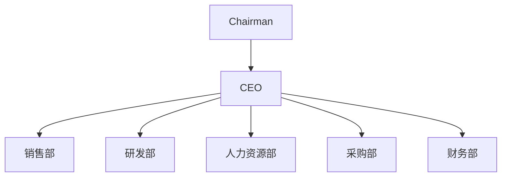

- 每位员工的**直属上级**（Line manager）= 员工档案里的“汇报对象”（Reporting To）。
- 组织以后可能增加层级（例如部门内设组长），审批机制按汇报链运行，不需要因此修改流程（见第 2 节）。

### 1.2 职级

| 职级 | 说明 | Odoo 中的识别方式 |
|---|---|---|
| L1 部门负责人 | 各部门的负责人；“销售主管”“研发主管”均指部门负责人 | 部门档案里的“负责人”（Manager） |
| L2 CEO | 所有审批链的最终职级 | 职能职位“CEO”的任职人（见 7.2） |
| L3 Chairman | 最高决策者 | 职能职位“Chairman”的任职人 |

公司目前人少，**不设金额分级**：需要走到 CEO 的单据，不论金额都到 CEO。

### 1.3 角色

| 角色 | 在流程中的职责 | Odoo 中的识别方式 |
|---|---|---|
| 员工 | 提交采购申请、出差申请、费用申请、报销 | 内部用户 |
| 销售 | 发起立项和报价、客户合同、销售出差与销售费用 | **Sales 部门（含下级部门）的员工**，系统按部门自动判断（#52） |
| 部门负责人 | 层级链上的审批 | 部门档案的负责人 |
| 项目经理 | 查看项目 BOM，按项目进度发起项目 PR | 项目主档上的“项目负责人” |
| 采购 | 询价、转 PO、维护产品和供应商、监控发货、登记收货 | 采购：用户 + 联系人创建 |
| CFO | 审批项目价格和商务条款；内部采购和项目采购付款；设置部门费用预算；销售费用报销最终审批并付款 | 职能职位“CFO”的任职人（待指定） |
| CEO | 层级链终点；审批所有 PO 和项目各关口 | 职能职位“CEO”的任职人 |
| Chairman | PO 超过门槛时联合审批；本人申请免审批 | 职能职位“Chairman”的任职人 |
| HR | **不参与任何采购审批**，看不到采购申请 | 员工：管理员 |
| admin | 只做系统管理（装模块、改配置、建用户、重置密码），不参与业务 | 设置 |

### 1.4 可见范围（权限原则）

**原则：流程不经过的人，就看不到。** 分两层控制：

- **菜单（板块入口）**：不参与该板块流程的人看不到这个板块。
- **数据（单据）**：板块内也只看到自己参与的单据（发起、审批、负责），另有规定的除外。审批人不需要进板块，从 To do 打开当前轮到自己审批的单据即可。
- **操作（按钮）**：只有负责这一步的角色能看到并操作，后端同样校验，不能只靠隐藏按钮。
- **部门负责人权限始终大于普通员工（#60）**：员工能做的操作，他**所在部门的负责人**也能做（例如下属请假时代为操作）。只到直属部门负责人，不再往上延伸到上级部门负责人（如 CEO、Chairman）。审批仍按审批链进行，代为操作不等于跳过审批。**例外：项目经理的操作**（发起项目 PR、申请交付验收、申请关闭）只由该项目指定的项目经理本人操作，不由其部门负责人代为操作；需要换人时由 CEO 改项目经理（已确认）。
- **系统管理员**：测试库中 admin 兼任 CEO，又有管理员特权，能看到所有业务按钮；正式库中系统管理员与 CEO 为两个独立账号，admin 只用于系统维护，不做日常业务。

**各板块谁能进入：**

| 板块 | 谁能看到 | 说明 |
|---|---|---|
| To do | 所有内部员工 | 点击直接打开当前账号的待审批、待处理、待修改列表；完成后移出；采购转单、CFO 账单付款、采购修改及收货均在此处理 |
| Human Resources（通讯录、请假、报销） | 所有员工 | 只看到自己的请假和报销；人员成本只给 HR、CFO、CEO（6.6） |
| Procurement › Procurement Requests | 所有员工 | 只看到自己提交或审批的 PR；采购看全部 |
| Procurement › Purchase（PO、供应商） | 采购、CFO、CEO、Chairman | |
| Projects | 所有员工 | 谁都可能被加入项目；只看到自己参与的项目，采购、CFO、CEO、Chairman 看全部（#38，#50） |
| Sales | Sales 部门员工、CEO、CFO | 采购、研发、HR 等看不到；研发和采购参与项目时在 Projects 里处理，不进 Sales（#51、#52） |
| Finance（Overview、Reports、Invoicing） | 只有 CFO、CEO、Chairman | 6.8.6 |
| Dashboard（运营看板） | 只有 CEO、Chairman | 6.9，#66；CFO 不进 |
| Dashboards（Odoo 自带的表格看板） | 不显示 | 与 AIIS 流程无关 |
| Apps、Settings | 只有系统管理员 | |

**各角色能看到的单据：**

| 角色 | 能看到的单据 |
|---|---|
| 销售 | 自己发起或参与的项目、报价单、销售订单；**只看自己参与的客户合同**（自己是销售、或是该合同的审批人）（#53）；自己的销售费用 |
| 销售部门负责人 | 本部门的报价单、销售订单、客户合同和销售费用 |
| 研发 | 参与的项目和 BOM；看不到价格 |
| 采购 | 全部 PR、PO、供应商；全部项目（填成本、询价、项目 PR）；**销售订单只看单号**：由销售订单生成的 PR / PO 上显示销售订单号，采购不能打开销售订单（#51） |
| CFO | 全部项目、合同、PO、账单、销售费用预算、财务板块 |
| CEO | 全部 |
| Chairman | 财务板块、PO、**全部项目**（#50）；不进 Sales |
| HR | 员工档案、人员成本；看不到采购申请 |

---

## 2. 审批机制

### 2.1 三类审批节点

| 节点类型 | 审批人怎么确定 | 举例 |
|---|---|---|
| **① 层级链** | 从申请人开始沿“汇报对象”逐级往上，**每一级都审批**，直到这类单据规定的终点职级 | PR 到部门负责人；立项、出差、费用申请到 CEO |
| **② 指定部门负责人** | 某个部门档案里的负责人，与申请人无关 | 目前没有单据使用（合同阶段原由研发部门负责人审批，#63 起由研发在合同核对时确认 BOM 代替） |
| **③ 职能职位** | 指定的职位，由该职位的**任职人**（一个人）审批 | CEO、Chairman、CFO |

节点可以串行，也可以**并行**（全部通过才进入下一步），也可以带条件（例如 PO 超过门槛才需要 Chairman）。

### 2.2 层级链的规则

| 情况 | 处理 |
|---|---|
| 正常 | 员工 → 部门负责人 →（终点为 CEO 时）CEO |
| 以后组织变成多层 | 自动多走中间几级，例如 员工 → 组长 → 部门负责人 → CEO，流程不用改 |
| 申请人本人已达到或高于终点职级 | 由他的上一级审批（例如部门负责人自己提 PR → CEO） |
| 申请人是 CEO | 上一级是 Chairman |
| 申请人是 Chairman | 免审批 |
| 汇报链断了（没有上级，或上级没有登录账号） | **跳到再上一级有账号的人；一直找不到就交给 CEO** |
| 同一个人在名单里出现多次 | 只审批一次 |

### 2.3 通用规则

| 规则 | 内容 |
|---|---|
| 名单固定 | **提交时生成审批人名单并固定**；审批途中组织调整不影响在途单据，新单据按新组织走；审批人离职由管理员改派 |
| 审批进度 | 单据上显示每一步的审批人、状态、时间、意见；当前审批人收到待办 |
| 驳回 | 必须填写原因；单据退回草稿，修改后重新提交，重新生成审批名单；**提交人收到带驳回原因的待办**，重新提交后待办自动完成（所有单据，#55） |
| PO 驳回 | CEO 或 Chairman 驳回 PO：PO 退回草稿（询价单）回到**采购**修改后重新提交；驳回原因同时写到关联的 PR 上并通知 PR 申请人（不含价格）（#54） |
| 被驳回单据的入口 | To do 的 **To Revise** 筛选：列出自己提交、被驳回且还没重新提交的单据（任何单据类型），显示驳回人和原因，点 Open 打开单据；重新提交或取消单据后从列表消失。单据（PR、PO）顶部显示红色横幅：驳回人、日期、原因（#56） |
| 表头流程提示 | 项目、采购申请 PR、采购订单 PO 及采购供应商账单表单顶部显示当前步骤和“待谁做什么”（姓名）；内容与 To do 同源，取该单据（以及 PO 的供应商账单）上所有人的未完成任务。账单上还按批准的付款计划说明现在可付多少，或下一阶段在等哪个节点（全部收货、验收）加几天、由谁完成、哪天起可付。PR 转成 PO 后显示 PO 在等 CFO 确认条件、CEO 审批、CFO 付款还是采购收货；没有待办时说明在等什么（#62、#64） |
| PO 门槛 | 所有 PO 都要 CEO 审批；含税金额（折算 SAR）**超过 300,000 SAR** 时，CEO 批准后还要 Chairman 联合审批；正好等于门槛只需 CEO |
| PO 中途修改 | CEO 批准后、Chairman 审批前修改了订单，CEO 的批准作废，需重新审批 |
| 价格可见性 | 普通员工和研发看不到采购价格；价格、成本、利润只对采购、CFO、CEO 可见。例外：内部 PR 上申请人**自己选填的参考价**，申请人和审批人能看到（#49） |
| HR | 不参与采购审批，看不到采购申请 |

### 2.4 各类单据的审批配置

| 单据 / 关口 | 审批节点 |
|---|---|
| 内部采购申请 PR | ① 层级链，终点 **部门负责人** |
| 项目采购申请 PR（交付、维保备件） | **不审批**：项目经理提交后直接到采购 |
| 采购订单 PO | ③ CFO（供应商条件确认）→ ③ CEO → ③ Chairman（仅超过 300,000 SAR） |
| 采购付款（内部、项目） | ③ CFO |
| 项目立项 | ① 层级链，终点 **CEO** |
| 方案审批 | ③ CEO |
| 询价审批 | ③ CEO（定利润点）→ ③ CFO（项目成本预算、税项与汇率）（#61、#63） |
| 合同 | ③ CFO（价格、商务条款、付款周期与付款条件）→ ③ CEO；驳回回到销售（#63） |
| 出差申请、差旅报销（交付、维保） | ① 层级链，终点 **CEO** |
| 维保工时申请（含延长） | ① 层级链，终点 **部门负责人** |
| 销售费用事前申请（出差、请客户吃饭、礼品等） | ① 层级链，终点 **CEO**；审批时显示部门预算 |
| 销售费用事后报销 | ① 层级链，终点 **CEO** → ③ CFO（最终审批并付款）；审批时显示部门预算 |
| 交付确认、项目关闭 | ③ CEO |

---

## 3. 流程一：公司内部采购

### 3.1 流程图

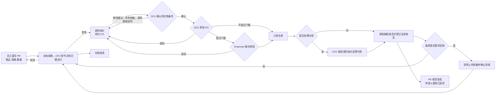

### 3.2 步骤

| # | 步骤 | 执行人 | 说明 |
|---|---|---|---|
| 1 | 填写并提交 PR | 员工 | 写物品、规格、数量、用途；可**选填参考单价和币种**（例如价格明确的软件订阅），不填由采购询价；产品库里没有的东西也能申请 |
| 2 | 审批 PR | 层级链至部门负责人 | 见 2.2 |
| 3 | 询价并转为 PO | 采购 | PR 批准后只通知**采购部**的采购人员（公司设置中的采购部门），“转为 PO”也只有他们能操作（#48）；即使申请人填了参考价，采购**仍然询价**；参考价作为 PO 的初始价格，采购按询价结果修改；选择或新建供应商；PR 中没选产品的行，系统按描述自动建产品；选择产品类别；同时填写 Supplier Terms & Payments、上传供应商确认依据并确认供应商已接受 |
| 4 | 确认供应商条件 | CFO | 核对采购记录的正式条件、依据和付款计划；确认后交 CEO，修改或澄清意见退回采购谈判，不直接覆盖供应商约定 |
| 5 | 审批 PO | CEO | CFO 确认后审批最终采购承诺；超过门槛时继续交 Chairman |
| 6 | 联合审批 PO | Chairman | 仅超过 300,000 SAR 时，CEO 之后 |
| 7 | 确认账单、分阶段付款 | CFO | 按全额 PO 生成账单并核对商业条件；实际付款受当前阶段金额、节点和日期控制。条件需变更时退回采购并重新走 CFO / CEO / Chairman |
| 8 | 跟踪收货与验收 | 采购 | 有预付款时付足才能收货；先货后款可直接收货；可分批收货，完整收货或附依据验收后才解锁相应尾款 |
| 9 | PR 完成与付款结清 | 系统 | PR 在全部收货后完成，申请人看到到货进度、不含价格；PO 的付款状态另行跟踪至付清 |

> 由销售订单生成的 PR，采购只看到销售订单号，不能打开销售订单（1.4、#51）。

> 收货由采购登记，申请人只查看、不需要再确认。

> 财务任务只分配给有效的 CFO 任职人；未配置时提示并回滚，不兜底给 CEO、采购或当前操作者。To do 按任务处理人和职责显示；旧 Bills to Process 链接也进入个人列表。

### 3.2.1 采购账单与批准 PO 一致（#57）

- CEO / Chairman 批准的是 PO 的供应商、币种、付款条件及产品、数量、计量单位、单价、折扣、税项。批准时由审批流程保存不可由接口写入的商业条件快照，并锁定这些条件；采购须先退回草稿，再修改并重新走完整审批，不能直接修改已批准 PO。
- 账单只由系统在 PO 最终批准时自动生成。PO 上不显示 Odoo 自带的 Create Bill 按钮；从其他入口（如列表的 Create Bills）调用时，不新建账单，直接打开该 PO 现有的账单（测试中发现 CEO 点 Create Bill 会尝试生成第二张数量为负的账单而报错）。
- 系统生成的供应商账单保留不可清除的 PO 关联；草稿账单的商业字段只读，后端同步禁止改价、改量、换产品、增删商品行、解除采购行关联、换供应商、币种、付款条件及公司。财务仍可处理账单日期、供应商发票号、会计日期、科目、分析维度、付款日期和银行日记账等财务信息。
- 确认账单（包括自动过账）和登记付款时，后端再次检查 PO 已完整批准、账单逐行商业条件及总额与 PO 一致。按计量单位、价格和币种精度比较；不允许新增未关联商品行或重复关联采购行来绕过校验；唯一例外是按件建资产的固定资产（例如单价达到资本化门槛的电脑，见 6.4）：开账单时系统按件拆成每行 1 件，同一采购行的各行合计数量须等于 PO 数量，单价、税项仍逐行与 PO 一致。当前自动预付流程按整个 PO 全量开账，不通过拆分账单规避核对；付款可以分次登记。
- 发现差异时，CFO 在草稿账单点击 **Return to Procurement**，填写原因。系统取消该 PO 尚未过账的草稿账单，关闭原付款待办，将 PO 退回草稿，并给采购负责人生成修改待办。采购修改后重提，CEO / Chairman 重新审批，系统生成新的账单及 CFO 付款待办。旧账单保留为已取消，不能恢复后付款。
- PO 如已有未取消且未完整冲销的过账账单（含部分或全部付款），禁止通过此入口直接退回或改价；先走标准贷项冲销/更正。完整冲销后可由采购退回 PO 草稿、修改并重批；原过账账单和贷项凭证均保留，不当作新的待付款账单。
- 上线时为存量已批准 PO 建立当前商业条件基线并补齐明确的账单关联，不自动改写历史金额；存量差异仍须退回或先作账务更正。
- 以上规则适用于内部采购及项目采购；不改变独立的费用报销和非采购账单流程。To do 只负责展示和进入单据，不提供绕过校验的付款入口。

### 3.2.2 供应商条件、CFO 审核与分阶段付款（#58）

- 新订单：采购录入供应商当前条件、上传确认依据并声明已获供应商确认，提交后先到 CFO；CFO 确认后才流转 CEO →（超过门槛时）Chairman。CFO 可以 Confirm Terms、Request Changes、Return for Clarification。后两项必须说明原因，修改建议单独保存，不能覆盖供应商正式条件；采购谈判、更新条件和附件后重新提交 CFO。
- 付款计划由结算方式和有序阶段组成：全额预付、先货后款、分阶段付款。比例按 PO 含税总额计算，每阶段保存比例、触发节点（PO 最终批准／全部收货／验收通过）和节点后的天数。比例合计 100%，最后阶段承担币种舍入差额；阶段不得逆序，必须依次结清，不因部分到货释放完整尾款。
- CFO 确认的是完整采购商业条件和付款计划的版本；改价、改数量、改供应商、付款条件或计划后都重新交 CFO。最终批准时的不可写快照同时包含付款计划和供应商依据，防止审批后换条件。已批准旧订单保留原流程，正式退回修改时转入新流程。
- 每阶段允许付款日期为触发日期加约定天数，未到日期或未达到节点不允许提前支付；可在允许日期以后分次付款，累计不超过当前阶段获批金额。为避免混合批次分配不清，分阶段采购账单按单张账单登记付款，付款币种与账单币种一致。普通非采购账单及旧订单付款保持原行为。
- 示例 30%＋70%：全部审批完成可付 30%；付足预付款后采购收到发货／收货待办；全部收货后尾款可付，若约定验收，则先由采购上传验收依据并确认通过，之后才允许尾款。尾款结清关闭付款待办。先货后款订单批准后可直接收货，不要求预付。
- 财务可以先确认全额账单，应付余额仍按全额记账；实际可付金额由阶段控制。账单展示当前阶段、解锁条件、允许付款日期和可付金额。付款窗口默认填当前可付金额，服务端在付款和对账核销入口重新校验，不能通过直接创建付款后核销绕过。
- To do：草稿账单可先确认；已过账账单仅在阶段可付款时出现。未来阶段的活动保留允许日期，日期到达后查询自动显示，无需人工重派；业务日期按公司联系人时区，未配置时使用 Asia/Riyadh；采购按预付款是否结清看到收货任务，按是否需验收看到验收任务。
- 新订单的供应商条件、依据和付款阶段由采购维护，CFO 仅确认或提出建议；收货与验收由采购登记。阶段条件未满足时，财务不能通过直接登记收货或伪造验收日期解锁付款。

### 3.3 实现状态

| 内容 | 状态 |
|---|---|
| 步骤 1–5、7、8；Chairman 免审批；HR 不参与 | 已在测试库实现，审批已迁移到审批引擎（`aiis_approval`）：PR 层级链至部门负责人，PO 为 CEO →（> 300,000 SAR）Chairman；“PR 备用审批人”权限组已取消 |
| CFO 前置审核及阶段付款 | 已实现（2026-11-04）：供应商条件先交 CFO，再到 CEO / Chairman；按预付款、收货、验收与日期生成待办并限制可付金额（#58）；旧已批准订单保留原规则，退回修改后进入新流程 |
| 采购账单商业条件控制 | 已实现（2026-11-04）：批准快照、PO / 账单商业字段锁定、过账与付款核对、填写原因退回采购、重新审批换新账单，保留标准贷项冲销路径（#57） |

---

## 4. 流程二：基于项目的审批

### 4.1 一级流程

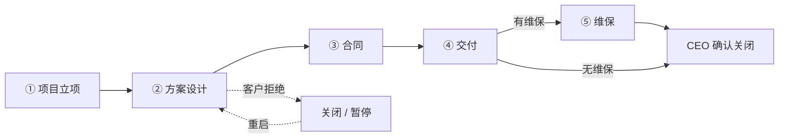

| 阶段 | 关口审批 | 产出 |
|---|---|---|
| ① 立项 | 层级链至 CEO（销售部门负责人 → CEO） | 项目编号、项目分析账户 |
| ② 方案设计 | CEO 审批方案；CEO 审批询价并定利润点 | 已批准的方案和 BOM、销售报价单 |
| ③ 合同 | 研发确认 BOM ∥ 采购确认价格 → 销售填合同条款 → CFO → CEO；驳回回到销售 | 最终项目报价、合同 |
| ④ 交付 | 项目经理提 PR 直接到采购 → PO（CEO）→ CFO 付款；CEO 确认交付成功 | 到货材料、交付验收 |
| ⑤ 维保 | 工时申请层级至部门负责人；维保期内服务；到期 CEO 确认关闭或续约 | 备件和差旅成本、工时统计、按期确认的收入 |

“∥”表示并行审批，两人都通过后才进入下一步。项目主档始终显示当前阶段。

### 4.2 ① 项目立项

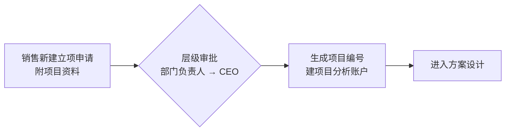

| # | 步骤 | 执行人 | 说明 |
|---|---|---|---|
| 1 | 新建立项申请 | 销售员工 | 客户、项目机会描述、预计金额、预计时间；**附上项目资料（Project Information）** |
| 2 | 审批 | 层级链至 CEO | 现在即：销售部门负责人 → CEO |
| 3 | 生成项目编号 | 系统 | 格式见 4.7；同时建立项目分析账户，用于归集成本和收入 |

### 4.3 ② 方案设计

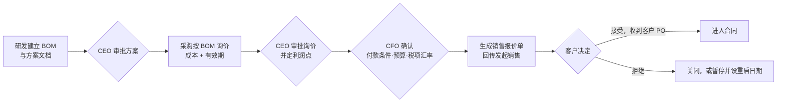

| # | 步骤 | 执行人 | 说明 |
|---|---|---|---|
| 1 | 建立 BOM 和方案文档 | 研发 | BOM 是持续更新的底稿，见 4.8；方案文档（设计说明、图纸等）直接上传到项目的 Solution Documents，提交方案时至少一份（#59） |
| 2 | 审批方案 | CEO | 针对 BOM 及方案文档的具体版本 |
| 3 | 询价 | 采购 | 按 BOM 询价，填写每行成本和报价有效期 |
| 4 | 审批询价、定利润点 | CEO | 利润点由 CEO 决定，按**毛利率**：报价 = 成本 ÷ (1 − 利润点)，例如成本 100、利润点 20% → 报价 125 |
| 4a | 确认财务事项（#61） | CFO | CEO 批准后轮到 CFO，在项目的 Finance 页签确认：**项目成本预算**（默认等于询价成本合计，可调整）；**税项**（默认 VAT 15%，用于报价所有行）；外币成本的**汇率**（默认当天汇率，可调整，确认后报价和报价成本按此汇率折算）。报价币种一律 SAR。付款条件不在这一步确认，合同阶段由销售填写、CFO 在合同审批时确认（#63）。CFO 驳回（填原因）退回询价阶段，重新提交后仍先 CEO 再 CFO |
| 5 | 生成销售报价单 | 系统 | CFO 批准后生成：由 BOM 成本（按 CFO 确认的汇率折算 SAR）+ 利润点生成，每个 BOM 行一行报价，税项按 CFO 确认，回传给发起立项的销售 |
| 6 | 客户决定 | 销售 | 接受：收到客户 PO 进入合同；拒绝：项目关闭，或暂停并填写预计重启日期（到期提醒销售），重启后回到本阶段 |

### 4.4 ③ 合同

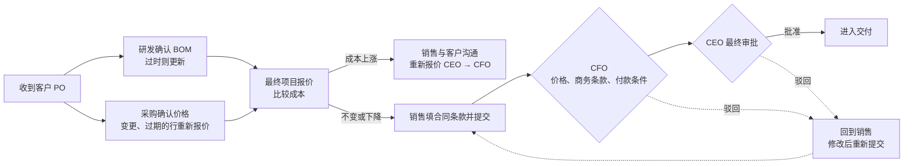

| # | 步骤 | 执行人 | 说明 |
|---|---|---|---|
| 1 | 登记客户 PO | 销售 | 记录客户 PO 号 |
| 2 | 确认 BOM 是否过时 | 研发 | 与第 3 步**同时进行**（#62）。例如型号停产、规格需更新。过时则更新 BOM，**变更的行也必须重新询价**；需要时同时更新方案文档，确认时记为新版本（#59） |
| 3 | 确认价格 | 采购 | 与第 2 步同时进行，**每次都要确认**（#62）：核对全部行的价格，价格有变的行更新单价和有效期；已过有效期的行、研发变更的行必须重新报价后才能点 Confirm Prices。确认后如研发再改 BOM 行或采购再改价格，该确认自动作废，需重新确认；研发确认后再改 BOM 行同样需研发重新确认 |
| 4 | 最终项目报价 | 系统 | 研发和采购都确认后，汇总最新成本并与报价时成本比较（见下方“成本变化”） |
| 5 | 填写合同条款并提交 | 销售 | 收到客户 PO 后由销售填写**商务条款**（交货期、质保、罚则等）、**付款周期**、**付款条件**，与客户合同一致（#63） |
| 6 | 审批价格与合同条款 | CFO | 最终确认：**价格、商务条款、付款周期、付款条件**；成本上涨如何处理在线下决定 |
| 7 | 最终审批 | CEO | CFO 之后；通过后进入交付 |

> - **驳回**：第 6–7 步任何一位审批人驳回（必须填写原因），合同关口退回**销售**；销售与客户沟通、修改后重新提交，重新生成审批名单。
> - 合同关口由销售提交，因此上面的报价、条款、付款周期和付款条件都记在合同关口上，供 CFO 审批。付款条件只在合同阶段由销售填写、CFO 确认，报价前不再确认（#63）。不再设研发部门负责人审批：方案已由 CEO 批准，合同阶段研发确认 BOM 即为最终方案确认（#63）。
> - **项目成本预算（#61）**：报价阶段 CFO 确认的预算，项目上显示预算、已承诺（已批准的项目 PO）、待批准、剩余；交付阶段项目 PO 超出预算时，PO 表单和审批时标红提示，不拦截，由审批人决定。成本上涨重新报价时，CFO 按新成本重新确认预算。
> - **销售的操作只给销售（#60）**：提交立项、登记客户接受 / 拒绝、成本上涨后发起重新报价、填写合同条款（商务条款、付款周期、付款条件）、提交合同、暂停后重启，只有本项目的发起销售、他所在部门的负责人（直属，不含上级部门负责人）和系统管理员能操作；维保起止日期另外允许项目经理填写。研发、采购等其他项目成员看不到这些按钮，合同条款只读。
> - **成本变化**：重新询价后，系统比较最新成本与报价时（询价审批通过时）的成本：
>   - 成本**持平或下降**：按原报价进入合同条款和审批，客户价格不变；
>   - 成本**上涨**：项目进入“重新报价”，销售先与客户沟通，然后发起重新报价，走询价审批（CEO 重新定利润点），生成新报价单；客户接受后重新进入合同阶段。
> - **销售订单**：项目合同审批通过后，系统自动确认该项目的销售订单；项目的销售订单不再需要“客户合同”审批（避免同一单审两次）。
> - 非项目销售仍使用现有的“客户合同”模块和其审批规则。

### 4.5 ④ 交付

**分批采购**

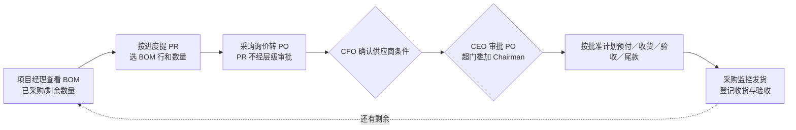

**出差、差旅与交付确认**

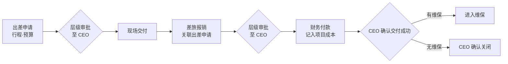

| 规则 | 内容 |
|---|---|
| 项目采购 | 必须走 PR，由**项目经理**按项目进度从 BOM 分批提；项目 PR **不经层级审批，直接到采购**（内部采购 PR 仍走层级链） |
| PO 与付款 | 采购转 PO 后 CEO 审批（超门槛加 Chairman）；批准后转 **CFO 付款**；付款后采购**监控发货并登记收货** |
| 防超量 | BOM 每行实时显示已申请、已下 PO、已收货、剩余数量 |
| 差旅 | 出差前申请、出差后报销，都走层级链至 CEO；**交付、维保出差**的差旅记为项目成本（损益表 Cost of revenue）。销售出差另见第 5 节 |
| 交付确认 | 项目经理发起“交付验收”，CEO 审批；批准后，合同页签填了维保起止日期的进入维保，没填的项目关闭 |
| 出差与报销（实现） | 出差申请为单独单据（行程、日期、预算），层级链至 CEO；差旅报销用 Odoo 费用报销，必须关联已批准的出差申请，报销单走审批引擎（层级链至 CEO）代替 Odoo 自带的经理审批，费用记到项目分析账户；之后由财务按 Odoo 标准流程过账、付款 |
| 在申请单上报销（#65） | 出差申请批准后，出差人**直接在申请单上报销**：Actual Expenses 页签逐行填实际费用（日期、说明、类别、金额），上传票据，点 **Submit Claim**，系统自动生成关联本申请的费用报告并提交审批。规则同第 5 节“在申请单上报销” |

### 4.6 ⑤ 维保

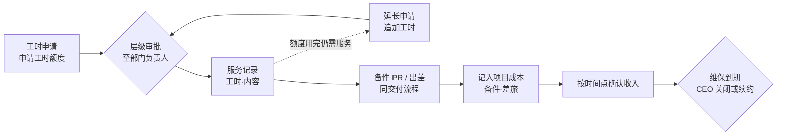

| 规则 | 内容 |
|---|---|
| 工时申请 | 内部服务人员开始服务前提交工时申请（项目、工时额度、服务内容、预计期间），走层级链至**部门负责人**；不产生采购单 |
| 工时控制 | 服务记录的工时累计不能超过已批准的额度；额度用完仍需服务时，再次提交**延长申请**（追加工时），同样层级审批 |
| 状态 | 项目显示为“维保中”，记录维保起止日期 |
| 成本 | 备件、差旅、外部服务费用记入项目成本；**内部人员工时只在项目上展示（已批准额度、已用、剩余），不折算成本、不计入项目成本**（工资已在 Personnel cost 中） |
| 收入 | 维保收入按合同约定的时间点（例如每季度）确认；具体做法依赖会计方案 |
| 无维保 | 交付后由 CEO 确认项目关闭 |
| 维保到期 | 项目经理发起“关闭项目”，CEO 审批；或由 CEO 续约（延长维保结束日期） |

### 4.7 项目编号与项目主档

- **项目编号** = 客户编码 + 年份 + 流水号，例如 `STC-2026-001`；CEO 批准立项时自动生成。
- **客户编码**：客户档案新增字段（如 STC），立项前必须填写。
- **项目主档**包含：

| 分类 | 内容 |
|---|---|
| 基本信息 | 项目编号、客户、发起销售、项目负责人（项目经理）、当前阶段、状态（进行中 / 暂停 / 关闭） |
| 关联单据 | 项目资料、BOM 和方案文档、询价、销售报价单、客户 PO、合同（含商务条款、付款周期、付款条件）、PR、PO、出差申请、差旅报销、维保工时申请、销售费用申请 |
| 审批记录 | 每道关口的审批人、时间、意见；驳回原因；当前审批人的待办 |
| 成本与收入 | 项目成本、项目收入、利润（利润仅采购、CFO、CEO 可见） |

**表头流程提示（#62）：** 项目表单顶部在每个阶段都显示当前步骤、待谁处理（姓名）以及已完成的人，例如合同核对时显示“研发：✓ 已由 Paul Williams 确认 BOM · 采购：等待确认价格”；审批中显示待审批人和后续审批人。

**谁指定项目经理：** 由 **CEO 在合同阶段指定**。销售在立项草稿阶段可以先填一位建议人选；提交立项后只有 CEO 和管理员能修改。合同审批最后一步批准前必须已指定项目经理，保证进入交付时有人负责。项目经理负责发起项目 PR、申请交付验收和关闭项目。

**谁能看到项目：** 只看自己参与的——发起销售、项目经理、项目成员（在项目上添加，例如负责 BOM 的研发）、该项目各关口的审批人能看到；采购、CFO、CEO、Chairman 看到全部项目。价格、成本、利润列仍按 4.8 只给采购、CFO、CEO（Chairman 同 CEO）。

### 4.8 BOM（材料清单）

| 操作 | 研发 | 采购 | CEO / CFO | 销售 | 项目经理 |
|---|---|---|---|---|---|
| 新增 / 修改 BOM 行 | ✓ | — | — | — | — |
| 查看物品、规格、数量、采购进度 | ✓ | ✓ | ✓ | ✓ | ✓ |
| 按 BOM 行发起项目 PR | — | — | — | — | ✓ |
| 填写成本、有效期 | — | ✓ | — | — | — |
| 查看成本和利润 | — | ✓ | ✓ | — | — |

- **谁算研发**：公司设置中的研发部门（Settings › Companies › R&D Department，安装时自动识别 Research & Development）里的员工，包括其下级部门和部门负责人。只有他们能新增、修改、删除 BOM 行，提交方案审批，以及在合同阶段确认 BOM；前提是能看到该项目（例如被加为项目成员）。
- **版本管理**：BOM 随时可改；每次送审保存一个版本；审批针对具体版本，审批后再改会标记“有变更”。合同阶段研发确认 BOM 时也保存一个版本（状态 Confirmed for Contract）。
- **方案文档（#59）**：项目上的 Solution Documents，用于上传设计说明、图纸、方案 PPT 等，免得逐项录入。只有研发能上传或删除，可改时间与 BOM 行一致：从方案设计到合同条款之前（Solution Design、Costing、Quotation Sent、Contract: BOM Check / Re-quote / Cost Increase）都可以改，方案审批、询价审批、合同条款及合同审批期间锁定，项目暂停或关闭时也锁定；方案批准后再改文档，项目消息记录自动写明新增或删除了哪些文件；能看到项目的人都能打开（不含价格，不受价格可见性限制）。提交方案和确认 BOM 时至少要有一份；每个版本保存当时文档的副本，之后项目上的文档增删不影响已送审版本，可在 BOM Versions 里对照。BOM 行仍需逐行录入，因为询价、项目 PR 和采购进度按行计算。
- **询价提示**：新增或修改的行自动提示采购需要询价。
- **每行记录**：物品、规格型号、数量、单位、产品库中的产品（可选）；采购填写供应商、单位成本、币种、报价有效期；采购进度（已申请 / 已下 PO / 已收货）。

**界面设计（样稿：[AIIS P&L and BOM Mockups › Project › BOM](https://claude.ai/artifact/3TtaTwh3r49j9S5geshGVx)，仅示意，实际以 Odoo 标准表单实现）：**

| 部分 | 内容 |
|---|---|
| 位置 | Projects › 项目 › BOM（项目主档上的页签或按钮进入） |
| 表头 | 操作按钮（按角色显示，见下）；右侧阶段进度条 Initiation → Solution Design → Contract → Delivery → Maintenance；标签显示 BOM 版本、审批状态、“Changed since approval”（批准后有变更的行数） |
| 字段 | Customer（含客户编码）、Project manager、BOM owner（R&D）、Customer PO |
| 页签 | BOM lines、Versions、Purchase requests、Approvals |
| BOM 行的列 | #、Item、Specification / model、Qty、Unit；Vendor、Unit cost、Currency、Quote valid until、Line cost (SAR)（这五列仅采购、CFO、CEO 可见，过期的有效期标红）；Requested、On PO、Received、Remaining；Status（Quoted / Quote expired / Changed · needs RFQ / Fully received，彩色标签） |
| 合计 | 已报价行的成本合计（SAR，外币按汇率折算），注明未报价的行；仅采购、CFO、CEO 可见 |
| 按角色的按钮 | 采购：Record quotations、Lines needing RFQ；研发：Edit lines、Submit version for approval；项目经理：Create purchase request |
| 发起项目 PR | 项目经理点 Create purchase request，弹出窗口勾选 BOM 行并填写本次数量（不能超过剩余数量），生成项目 PR 直接到采购 |
| 价格隐藏 | 按权限组控制列的显示，研发和项目经理登录后看不到价格列（样稿中的“Preview as”切换只用于演示） |

### 4.9 成本与收入口径

| | 内容 | 对应损益表（见第 6 节） |
|---|---|---|
| 项目成本 | BOM 材料（项目 PR / PO）、交付和维保的差旅、维保备件和外部服务费用（内部工时只展示，不计成本）；全部通过项目分析账户归集 | Cost of revenue |
| 项目收入 | 合同 / 销售订单金额；维保收入按约定时间点确认 | Recognized revenue |
| 项目利润 | 收入 − 成本，按项目查看，进入财务看板的“项目”维度 | 项目层面的 Gross profit |
| 与现状的差别 | 现在所有员工报销（含差旅）都记为内部费用；改造后，交付和维保的差旅记为项目成本 | |

---

## 5. 销售出差与销售费用

销售为开拓和维护客户产生的费用：**销售出差**，以及**请客户吃饭、购买礼品**等招待费用。

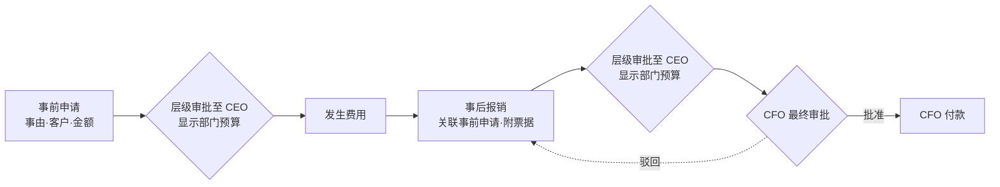

| 规则 | 内容 |
|---|---|
| 流程 | **事前申请 + 事后报销**。事前申请走层级链至 CEO（现在即：部门负责人 → CEO）；事后报销走层级链至 CEO 后，由 **CFO 最终审批并付款** |
| 驳回 | 任何一级驳回（包括 CFO 拒绝付款），单据都退回**发起人**，修改后重新提交 |
| 部门预算 | CFO 为每个部门设置销售费用预算（对应 Sales travel and entertainment，按年度，可分季度）。审批时，每一级审批人在单据上看到**所在部门**的预算、已占用（已批准的事前申请 + 已报销）、本单通过后的剩余，据此审批；CEO 和 CFO 可以看到所有部门。超预算时醒目提示，但不禁止提交，由审批人决定 |
| 预算可见 | 预算框只给该单据的审批人、CFO、CEO 和管理员看，申请人看不到部门预算 |
| 已占用的算法 | 期间内本部门已批准的事前申请：已报销的按报销金额计，未报销的按预计金额计（同一笔不重复计算） |
| 实现方式 | 事前申请为单独单据“Sales Expense Request”（类型：销售出差 / 请客户吃饭 / 礼品；客户、事由、预计金额、可选关联项目；出差另填目的地和日期）；事后报销用 Odoo 费用报销单，关联已批准的事前申请，走审批引擎：层级链至 CEO → CFO；CFO 批准后收到过账并付款的待办 |
| 在申请单上报销（#65） | 事前申请批准后，员工**直接在申请单上报销**，不用另到 Expenses 建报告：Actual Expenses 页签逐行填实际费用（日期、说明、类别、金额；类别按申请类型给默认值），上传票据（至少一张），点 **Submit Claim**，系统自动生成关联本申请的费用报告并提交报销审批（审批人、预算显示、CFO 付款都不变）。申请单状态栏延长为 Draft → Submitted → Approved → **Claim Submitted** → **Paid**；Approvals 页签同时显示申请审批和报销审批 |
| 报销规则（#65） | **每张申请只报销一次**，一次性提交全部实际费用（已有未作废的报销单就不能再建第二张）。申请金额只是预估：实际金额**超过申请金额也允许提交**，申请单和报销单上标红提示，由审批人决定。报销被驳回时退回申请单，员工修改明细或票据后重新 Submit Claim。员工本人和其直属部门负责人（#60）可以填写和提交 |
| 备用入口（#65） | 原来的方式保留：在 Expenses 里建费用报告、手动选这张申请，效果相同，也计入“只报一次” |
| 关联 | 报销必须关联已批准的事前申请；可关联客户；有项目时可关联项目（仅用于追溯） |
| 费用类别 | **Sales expenses › Sales travel and entertainment**（销售差旅与招待），即使关联了项目也不记为项目成本 |
| 与交付出差的区别 | 交付、维保阶段的出差记为项目成本（4.5）；销售出差（拜访客户、售前等）记为 Sales expenses |

---

## 6. 财务口径：损益表与费用分类

依据公司的 2026 年损益表模板（2026 Profit & Loss Forecast，系统只沿用其行结构）。系统里产生的每一笔收入、成本、费用，都要能归到这张表的某一行。**系统中的财务数据一律按实际发生统计，不录入、不显示预测。**

### 6.1 损益表结构

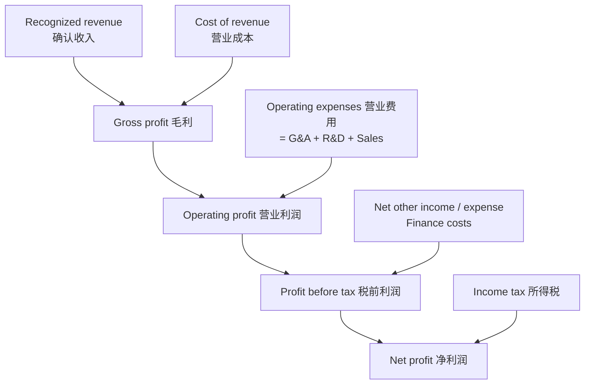

| 行 | 计算 |
|---|---|
| Gross profit | Recognized revenue − Cost of revenue |
| Total operating expenses | G&A + R&D + Sales expenses |
| Operating profit | Gross profit − Total operating expenses |
| Profit before tax | Operating profit + Net other income − Finance costs |
| Net profit | Profit before tax − Zakat − Income tax |

另有 Gross / Operating / Net profit margin（各项利润 ÷ 收入）。

> - **折旧**：单价 ≥ 5,000 SAR 的设备作为固定资产折旧，折旧**统一计入 G&A › Depreciation and amortization**；R&D 和 Sales 下的折旧行保留但始终为 0（见 6.4）。
> - **所得税**：模板中的 “Income tax expense” 在系统中拆成两行 **Zakat** 和 **Income tax**，合计等于原行（见 6.7.5）。

### 6.2 营业费用的三大类和明细

| General & administrative（G&A，管理费用） | Research & development（R&D，研发费用） | Sales（销售费用） |
|---|---|---|
| Personnel cost（人员成本，取自 HR） | Personnel cost（人员成本，取自 HR） | Personnel cost（人员成本，取自 HR） |
| Office rent and utilities（办公租金与水电） | Development cloud and compute（开发用云与算力） | Marketing and advertising（市场与广告） |
| Legal, audit and professional fees（法务、审计与专业服务） | Development software and tools（开发软件与工具） | Sales travel and entertainment（销售差旅与招待） |
| Insurance, licenses and administration（保险、执照与行政） | Contractors and technical consulting（外包与技术咨询） | Events, exhibitions and sponsorship（活动、展会与赞助） |
| IT systems and subscriptions（IT 系统与订阅） | Research, testing and prototypes（研究、测试与样机） | Commissions and channel incentives（佣金与渠道激励） |
| Travel, training and recruitment（差旅、培训与招聘） | Depreciation and amortization（折旧摊销） | CRM and sales tools（CRM 与销售工具） |
| Depreciation and amortization（折旧摊销） | Other R&D expenses（其他研发费用） | Depreciation and amortization（折旧摊销） |
| Other administrative expenses（其他管理费用） | | Other sales expenses（其他销售费用） |

### 6.3 归类规则：按“职能”和“性质”两个维度

同一样东西，归到哪一大类取决于**谁用它（职能）**，归到哪一明细取决于**它是什么（性质）**。例如同样是软件订阅，研发用的记 R&D › Development software and tools，行政用的记 G&A › IT systems and subscriptions。

**职能（大类）由部门决定：**

| 部门 | 营业费用大类 |
|---|---|
| 销售部 | Sales |
| 研发部 | R&D |
| 人力资源部、财务部、采购部、CEO、Chairman | G&A（已确认） |

**先判断是不是项目成本：** 关联了项目、且属于项目交付或维保的支出（BOM 材料、交付和维保差旅、维保备件和外部服务费用），记 **Cost of revenue**，不进营业费用。

### 6.4 系统中各类支出的归属

| 支出来源 | 归属 |
|---|---|
| 项目 PR / PO（BOM 材料、分包、转售软件、给客户的云服务） | Cost of revenue |
| 交付、维保出差的差旅报销 | Cost of revenue |
| 销售出差、请客户吃饭、礼品（第 5 节） | Sales › Sales travel and entertainment（礼品与招待合并） |
| 内部采购 PR / PO | 按申请人部门定大类，按物品性质定明细（例如研发部买开发工具 → R&D › Development software and tools） |
| 人员成本（工资、签证费、Iqama 居住证费、保险、社保等，见 6.6） | 各大类的 Personnel cost — linked to HR，按员工所在部门 |
| 非销售、非研发人员的非项目差旅、培训、招聘 | G&A › Travel, training and recruitment |
| 研发人员的非项目差旅（例如参加技术会议） | R&D › Other R&D expenses |
| 采购部、CEO、Chairman 的费用 | G&A |
| 电脑、服务器、家具等设备（非项目），**单价 < 5,000 SAR** | 一次性计入费用；不论哪个部门使用，统一归入 **G&A › Other administrative expenses**（6.3 按部门定大类的规则的例外） |
| 同上，**单价 ≥ 5,000 SAR** | 登记为**固定资产**，按使用年限每月折旧；折旧不论部门统一计入 **G&A › Depreciation and amortization** |
| 给客户项目买的设备 | 不是公司资产，属于项目成本（Cost of revenue） |

### 6.5 对现有系统的影响

| 现有内容 | 需要的调整 |
|---|---|
| 产品类别（Project Cost / Internal Expense 两棵树） | Project Cost 保留，对应 Cost of revenue；Internal Expense 改为按**性质**分的明细，大类由部门自动决定 |
| 会计科目 | 按 6.2 每个明细建一个费用科目，并按 G&A / R&D / Sales 分组；Cost of revenue 单独一组 |
| 财务看板 | 改为财务板块（见 6.8）：Overview 总览四项指标 + Reports 报表；现有现金口径看板改造为其中的 Cash Flow 报表；损益表、资产负债表按权责发生制另建（见 6.7） |
| 分析账户 | 两个维度：**部门**（决定大类）和**项目**（归集项目成本和收入） |

### 6.6 人员成本（Personnel cost — linked to HR）

| 规则 | 内容 |
|---|---|
| 组成 | 工资，以及员工相关费用：签证费、Iqama 居住证费、保险、社保（GOSI）等，类型清单可由 HR 增加 |
| 录入 | **由 HR 在系统里按员工逐笔录入**（员工、费用类型、金额、发生日期、收款方） |
| 可见性 | **员工本人看不到**；只有 HR、CFO、CEO 可以查看 |
| 计入时间 | **按实际发生时计入**（发生日期所在的期间） |
| 归属 | 按员工所在部门，计入 G&A / R&D / Sales 对应大类的 Personnel cost |
| 工资部分 | 合同工资按月计入 |
| 员工服务终止补偿（End-of-service benefits） | 沙特劳动法规定员工离职时必须支付（前 5 年每年半个月工资，之后每年一个月；主动辞职按年限打折）。**现阶段不按月计提**：员工离职实际支付时，计入其所在部门的 Personnel cost。资产负债表保留该负债行、暂为 0。以后员工增多或需要审计时，再加上按入职日期和合同工资自动按月计提 |

### 6.7 财务报表方案（权责发生制）

#### 6.7.1 原则

| | 现金口径（现有看板） | 权责发生制（损益表、资产负债表） |
|---|---|---|
| 收入何时确认 | 客户付款时 | 给客户开发票过账时；维保收入按约定时间点分期确认 |
| 成本费用何时确认 | 付款给供应商时 | 收到供应商账单、费用实际发生时 |
| 未收的钱 | 看不到 | 应收账款（资产） |
| 未付的钱 | 看不到 | 应付账款、应交税费等（负债） |

前提：**所有业务都在 Odoo 中完整复式记账**，否则资产负债表不准确（见 6.7.7）。

#### 6.7.2 数据流

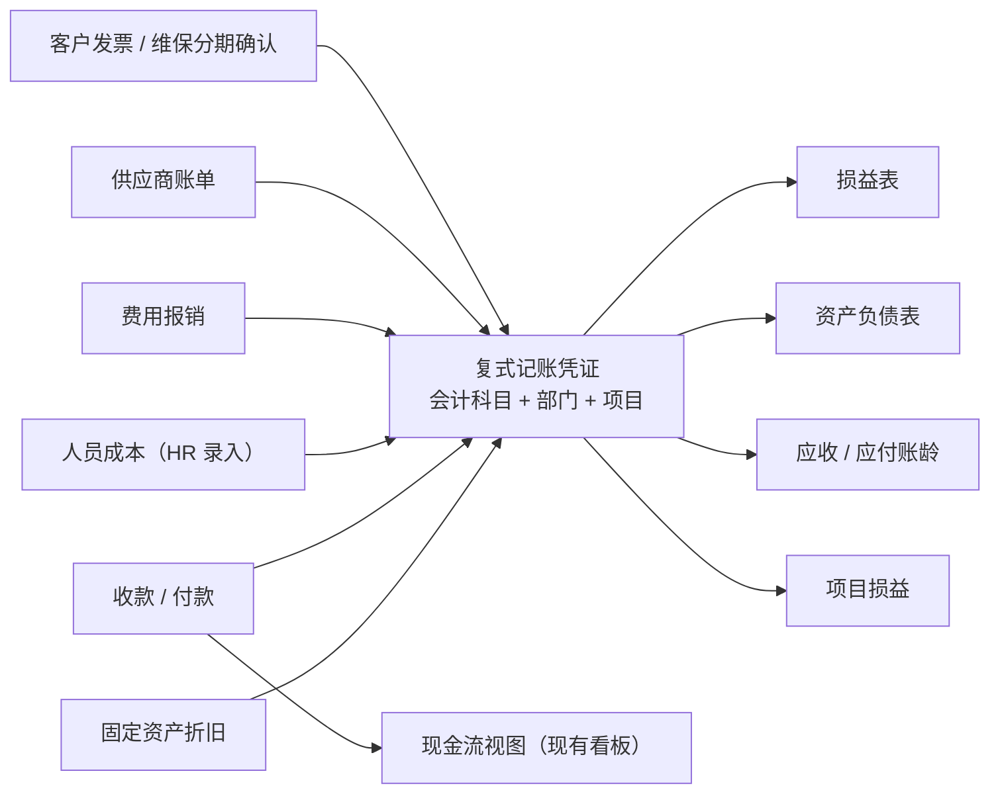

#### 6.7.3 会计科目与维度

- 以沙特标准科目表（Odoo 自带 `l10n_sa`）为基础；费用部分按 6.2 每个明细建一个科目，按 G&A / R&D / Sales 分组，Cost of revenue 单独一组。损益表每一行直接对应科目。
- 分析账户两个维度：**部门**（决定费用大类）、**项目**（项目损益）。

#### 6.7.4 各类业务的记账

| 业务 | 记账方式 |
|---|---|
| 项目收入 | 按合同节点开客户发票，过账即确认收入、形成应收；收款后核销 |
| 维保收入 | 开票后先挂**预收（递延）收入**，按约定时间点分期确认收入（OCA `account_spread_cost_revenue`） |
| 采购 | PO 收货后录入供应商账单，过账即确认成本或费用、形成应付；付款后核销 |
| 费用报销 | 过账即确认费用，形成应付员工款；付款后核销 |
| 人员成本 | HR 逐笔录入（6.6）自动生成凭证，按部门计入 Personnel cost |
| 固定资产 | 单价 ≥ 5,000 SAR 的设备登记资产卡片，每月自动折旧（OCA `account_asset_management`）；年限：电脑、笔记本 3 年，服务器、网络设备 5 年，家具 5 年 |
| 预扣税（暂不做，需要时再加） | 供应商档案标记“境外、在沙特无常设机构”；其供应商账单按服务类型自动计算预扣税（5% / 15% / 20%），从应付款中扣下、计入“应交预扣税”，次月 10 日前由 CFO 向 ZATCA 申报缴纳 |
| 增值税 | 15% 增值税自动计入应交 / 应收增值税；ZATCA 电子发票使用 Odoo 自带 `l10n_sa_edi`，具体要求待会计确认 |

#### 6.7.5 Zakat 与所得税

公司为混合所有制（沙特股东 51%，外国股东 49%），两项都要缴纳，分开计算，每年在财年结束后 120 天内向 ZATCA 申报：

| | Zakat | 所得税 |
|---|---|---|
| 对应股东 | 沙特股东 51% | 外国股东 49% |
| 计算 | Zakat 计税基数 × 51% × 2.5% | 调整后应税利润 × 49% × 20% |
| 损益表 | 单独一行 **Zakat** | 单独一行 **Income tax** |
| 资产负债表 | Zakat payable | Income tax payable |

系统中设两个独立科目；持股比例变化时只影响金额，不需要改系统。具体计算以税务顾问为准。

#### 6.7.6 报表与工具

Odoo 社区版没有财务报表，使用 OCA 模块（均有 Odoo 17 版本），**按公司模板自行配置**，不使用 OCA 自带的简易模板。OCA 模块固定版本后复制在 `addons/oca/`（来源和版本见其中的 README），维保收入分期用的 `account_spread_cost_revenue` 在 OCA account-financial-tools 仓库：

| 报表 | 工具 | 说明 |
|---|---|---|
| 损益表 | `mis_builder` | 按 6.1、6.2 逐行配置；列为 Q1–Q4（或各月）和全年；可导出 Excel |
| 资产负债表 | `mis_builder` | 按下表结构配置；列为各季度末余额 |
| 应收 / 应付账龄、总账、试算平衡表 | `account_financial_report` | 账龄分为未到期、1–30、31–60、61–90、90 天以上 |
| 客户对账单 | `partner_statement` | |
| 现金流 | 改造现有财务看板（见 6.8.4） | 现金口径 |

**资产负债表结构：**

| 部分 | 行 |
|---|---|
| 流动资产 | 银行存款；应收账款；进项增值税；预付供应商款；其他应收（员工借支、押金） |
| 非流动资产 | 固定资产（原值 − 累计折旧）；其他非流动资产（长期押金） |
| 流动负债 | 应付账款；应交增值税；预提费用；应付工资和员工报销；预收维保收入；客户预付款；Zakat payable；Income tax payable（预扣税暂不做，以后需要时增加“应交预扣税”） |
| 非流动负债 | 员工服务终止补偿准备（现阶段为 0，见 6.6） |
| 权益 | 实收资本；以前年度累计利润；本年利润（取自损益表累计净利润） |
| 校验 | 资产 − 负债 − 权益 = 0 |

#### 6.7.7 前提条件

| 事项 | 说明 |
|---|---|
| Odoo 作为正式账簿 | 所有发票、账单、收付款都在 Odoo 记录（已确认） |
| 记账人员 | **CFO** 负责日常录入和核对、月末对账结账（已确认） |
| 期初余额 | 上线日的银行、应收、应付、预收等余额导入 |
| 银行对账 | 收付款与银行流水核对（手工或导入对账单） |
| 增值税与 ZATCA | 申报和电子发票要求由会计确认 |
| 审计 | 以后如做年度审计，科目表、报表口径、资本化门槛、终止补偿请审计师确认 |

#### 6.7.8 实施顺序

1. 前提条件已确认（Odoo 作为正式账簿，CFO 负责）
2. 正式库建立科目表、部门与项目分析维度
3. 业务单据到凭证：客户发票、供应商账单、费用报销、人员成本、收付款、固定资产折旧
4. 配置报表：损益表、资产负债表、账龄
5. 维保收入分期确认
6. ZATCA 电子发票

### 6.8 财务板块（Finance 菜单）

依据财务需求审查模板（AIIS Financial Reports、AIIS OA Financial Review）。界面名称为英文。

#### 6.8.1 菜单结构

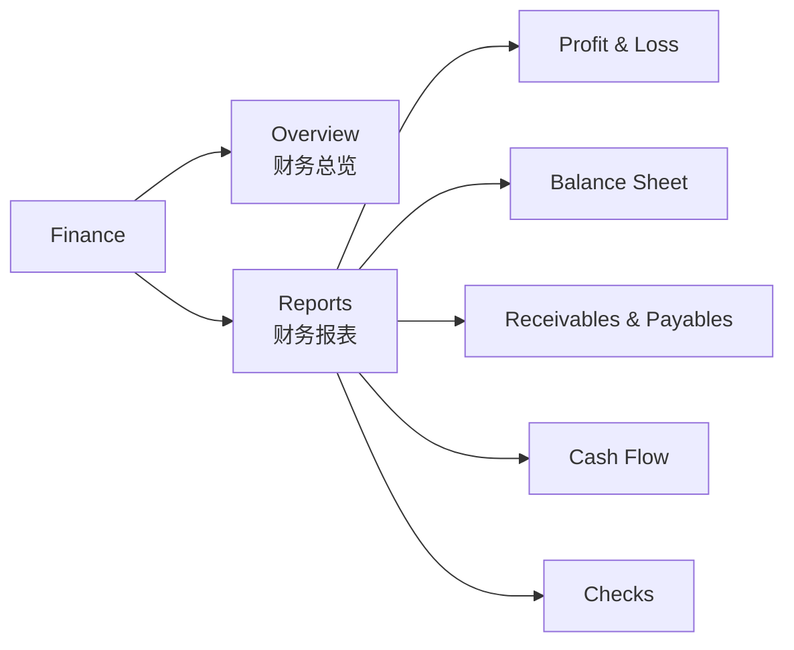

| 菜单 | 内容 |
|---|---|
| Overview | 四项指标卡片 + 按季度对比（见 6.8.2） |
| Reports › Profit & Loss | 损益表（见 6.8.3） |
| Reports › Balance Sheet | 资产负债表 |
| Reports › Receivables & Payables | 应收 / 应付账龄、客户对账单 |
| Reports › Cash Flow | 现金流（现金口径，由现有看板改造，见 6.8.4） |
| Reports › Checks | 核对区（见 6.8.5） |

现有的 Revenue / Cost / Expense / Overall Profit 四个现金口径菜单并入 Cash Flow，不再单独显示。

#### 6.8.2 Overview：四项指标

| 指标（界面名称） | 含义 | 计算口径 | 时间 |
|---|---|---|---|
| **Sales Order Value** | 客户订货金额 | 期间内确认的销售订单未税金额（折算 SAR），取消的订单扣除；**不是收入，也不是现金** | 期间 |
| **Recognized Revenue** | 已确认收入 | 期间内过账的收入科目金额（客户发票、维保收入分期确认），扣除贷项；与损益表 Recognized revenue 一致 | 期间 |
| **Gross Profit** | 毛利 | Recognized revenue − Cost of revenue，同时显示 Gross margin %；与损益表一致 | 期间 |
| **Order Backlog** | 在手订单（已签未确认收入） | 截止日所有已确认、未取消的销售订单未税金额 − 这些订单累计已确认的收入；包含未开票部分，以及已开票但仍挂在预收维保收入中的部分 | 截止日 |

| 规则 | 内容 |
|---|---|
| 筛选 | 期间（月 / 季度 / 年，默认本年）和截止日；可按项目、客户筛选 |
| 季度对比 | 卡片下方按 Q1–Q4 列出四项指标的**实际数**；尚未发生的季度显示为空，不做预测 |
| 下钻 | 点击指标打开明细（销售订单、收入凭证行），可追溯到单据 |
| 币种 | 全部折算为 SAR |

#### 6.8.3 Profit & Loss / Balance Sheet

| 报表 | 内容 |
|---|---|
| Profit & Loss | 行按 6.1、6.2（含 Gross / Operating / Net profit margin、Zakat、Income tax）；列为 Q1–Q4 和 Full year，全部为实际发生数，Full year = 本年截至截止日的累计实际；每个大类可展开到明细行和凭证；附“口径”说明，例如“采购单承诺额不计成本”“维保收入按计划分期” |
| Balance Sheet | 结构按 6.7.6；列为各季度末的实际余额（当前季度取截止日余额）；最后一行“资产 − 负债 − 权益”必须为 0 |

**Profit & Loss 界面设计（样稿：[AIIS P&L and BOM Mockups › Finance › Reports › Profit & Loss](https://claude.ai/artifact/3TtaTwh3r49j9S5geshGVx)，仅示意，实际为 `mis_builder` 报表样式，AIIS 绿色主题）：**

| 部分 | 内容 |
|---|---|
| 位置 | Finance › Reports › Profit & Loss |
| 筛选 | Fiscal year、Cutoff date、Columns（Quarters / Months）、Project、Department |
| 按钮 | Export Excel、Export PDF |
| 说明行 | Accrual basis · SAR · Actual figures only |
| 列 | Line、Q1、Q2、Q3、Q4、Full year (to cutoff)；截止日之后的季度为空 |
| 行 | 按 6.1、6.2 共 40 行：大类行（底色区分）、明细行（缩进）、合计行（Gross profit、Total operating expenses、Operating profit、Profit before tax）、Net profit（深色强调）、三个利润率（斜体） |
| 下钻 | 点击金额打开对应的凭证行 |
| 数据来源 | 样稿中的“Data source”列只用于说明每行取数，正式报表不显示；每行的取数来源以样稿和 6.4 为准 |

#### 6.8.4 Receivables & Payables / Cash Flow

| 报表 | 内容 |
|---|---|
| Receivables & Payables | 截止日的应收（AR）、应付（AP）账龄，**按到期日**分为 Not due、1–30、31–60、61–90、90+；可按客户 / 供应商展开到发票；客户对账单（`partner_statement`） |
| Cash Flow | 行：Opening cash、Customer receipts、Project supplier payments、Operating expense payments、Capital expenditure payments、Tax payments、Net cash change、Closing cash；列为 Q1–Q4 的实际数；附“客户收款与项目付款”按季度的折线图 |

| 口径 | 内容 |
|---|---|
| 账龄 | 必须按截止日**还原当时的核销状态**计算，不能直接用今天的未结余额（`amount_residual`）；贷项、预付款、多币种要专门测试 |
| 现金 | 只取已与银行流水核对的收付款；内部转账相互抵消；**登记付款不等于银行已扣款**；收付款含税 |
| 期末现金 | Closing cash 应与资产负债表的银行存款一致 |
| 现有看板 | 现在按 `account.payment` 统计，需改为按银行已核对的收付款统计，并按上表的行重新分类 |

#### 6.8.5 Checks：核对区

只用于观察，不参与业务计算；差额应为 0，不为 0 时标红：

| 核对项 | 比较 |
|---|---|
| 应收账龄 vs 资产负债表 | 账龄合计 = 应收账款余额 |
| 应付账龄 vs 资产负债表 | 账龄合计 = 应付账款余额 |
| 项目收入 vs 公司收入 | 各项目收入合计 = 累计 Recognized revenue |
| 项目成本 vs 营业成本 | 各项目成本合计 = 累计 Cost of revenue |
| 项目应收 vs 公司应收 | 各项目应收合计 = 应收账款余额 |
| 项目应付 vs 公司应付 | 各项目应付合计 = 应付账款余额 |

#### 6.8.6 权限

| 内容 | 谁能看 |
|---|---|
| Finance 菜单（Overview、Reports） | **只有** CFO、CEO、Chairman（已确认）。权限组随这三个职位的任职人自动更新，换人时新任获得、前任失去（包括该组附带的会计查看权限）；银行对账权限同样只跟随 CFO |
| 导出（Excel / PDF） | 同上，单独设置导出权限 |
| 其他所有人（包括采购、HR、admin 业务账号） | 看不到财务板块；字段级权限控制，不依赖报表配色或隐藏列 |

#### 6.8.7 实现方式

| 部分 | 方式 |
|---|---|
| Overview | 自研总览页面（模块 `aiis_finance`；指标卡片、季度对比、下钻） |
| Profit & Loss、Balance Sheet | `mis_builder`，按公司模板配置；打开时先选 Fiscal year、Cutoff date、Columns（Quarters / Months）、Project、Department |
| Receivables & Payables | `account_financial_report`（账龄，区间 Not due、1–30、31–60、61–90、90+）、`partner_statement`（对账单：在客户 / 供应商列表中选中后 Action › Partner Statement） |
| Cash Flow | 自研，取代现有看板的四个现金口径菜单（见 6.8.4）；银行流水的录入与核对用 OCA `account_reconcile_oca`（#46） |
| Checks | 自研，与报表使用同一套科目归属；另加一项“未归入任何报表行的科目” |

**科目归属（报表行）：** 每个科目有一个“报表行”字段（Report Line），损益表、资产负债表、总览、核对区都按它汇总，因此测试库（通用科目表）和正式库（沙特科目表 `l10n_sa`）用同一套报表。新科目按科目类型给默认报表行，CFO 可在科目上修改；AIIS 自己的科目为 7 位编码，不与 `l10n_sa` 冲突。

**记账规则的实现（6.3、6.4）：**

| 规则 | 实现 |
|---|---|
| 部门职能 | 部门上设 Expense Function（G&A / R&D / Sales），空则沿用上级部门，最上层默认 G&A；安装时研发部设为 R&D，名称以 Sales 开头的部门设为 Sales |
| 性质 → 科目 | 映射表 Expense Account Mapping（Invoicing › Configuration）：产品类别（性质）× 职能 → 科目，CFO 维护（#45）；内部费用类别按 6.2 的性质重建 |
| 采购账单 | 来自 PR 的账单行：项目 PR → Cost of revenue；内部 PR → 按申请人部门职能和产品类别查映射表；设备类别单价 ≥ 门槛（公司设置，默认 5,000 SAR）→ 固定资产科目，过账时按数量每台生成资产卡片 |
| 费用报销 | 交付 / 维保出差报销 → Cost of revenue（项目差旅）；销售出差与招待 → Sales › Sales travel and entertainment；其余按员工部门职能和产品类别查映射表 |
| 部门维度 | 每个部门自动建一个分析账户（分析计划 Departments），非项目的账单行、报销行、人员成本自动带上 |
| 人员成本 | Employees › Personnel Costs：HR 录入（员工、类型、金额、日期、收款方），过账为“部门职能的 Personnel cost / 应付员工款”；每月工资任务改为按合同生成工资记录（以前已按旧方式直接记银行的月份不重复）；员工本人、普通用户看不到 |
| 固定资产 | OCA 资产管理：三个资产类别（电脑笔记本 3 年，服务器网络设备 5 年，家具 5 年），直线法按月，折旧计 G&A › Depreciation and amortization；每日自动生成到期的折旧凭证 |
| 维保收入 | 产品类别 Maintenance Services 的收入科目为 Maintenance revenue；客户发票过账后自动转入预收维保收入，按月（默认 12 个月，CFO 可在发票行的分期表上改）确认收入 |
| 权限 | 权限组 Finance Board (CFO, CEO, Chairman)：Overview、Reports 菜单和其导出；安装时自动加入 CFO、CEO、Chairman 职位的任职人；Invoicing › Reporting 里的 OCA 报表菜单也只给该组 |

### 6.9 运营看板（Dashboard 板块，#66）

给 CEO 和 Chairman 看公司**每天、每月、每季度的运营情况**：钱花在哪里、流程卡在哪里、项目走到哪一步。它和财务板块（6.8）是**两个独立的功能**：财务板块回答“账上赚了多少、欠了多少”（按凭证、权责发生制），运营看板回答“业务上发生了什么”（按单据和流程）。两者可以有相同的数字，运营看板需要财务数字时**直接调用财务板块的同一套计算**，不另算一遍，保证两边一致。

| 规则 | 内容 |
|---|---|
| 谁能看 | **只有 CEO 和 Chairman**（按职位自动加入权限组 Operations Dashboard，换人自动跟随；CFO、部门负责人、admin 业务账号都看不到）。后端同样校验 |
| 菜单 | 新的顶层板块 **Dashboard**，与 Finance 并列；不放在 Finance 里面 |
| 数据范围 | 全公司，不受看板用户自己单据权限的限制（例如 Chairman 不进 Sales，看板上仍能看到销售费用和赢单率的统计） |
| 只看实际 | 全部按已发生的单据统计，不做预测（同 #35）；金额一律折算 SAR，取消、作废的单据不计 |
| 实时 | 打开或切换期间时现算，不建快照表；数字与单据当时状态一致 |
| 部门 | 所有按部门的统计、筛选都取系统里现有的部门（hr.department），不写死部门名称；新增或调整部门后自动跟随。交付、维保由研发部门（Research & Development）的人员执行，没有单独的交付部门 |

#### 6.9.1 时间筛选

| 项目 | 内容 |
|---|---|
| 期间 | **Day / Month / Quarter / Year**，**默认本月**；可用左右箭头切换上一期 / 下一期，或选自定义起止日 |
| 对比 | 每个指标卡片显示与**上一期**的对比，涨跌用箭头和百分比；上一期为 0 时只显示差额。本期还没过完时，和上一期的**同一段时间**比（例如 11 月 1–8 日对比 10 月 1–8 日，不是对比整个 10 月），否则月初总是显得大幅下降 |
| 趋势图 | 期间内的走势：选 Month 时按天，选 Quarter 时按月，选 Year 时按月，选 Day 时不显示趋势图 |
| 时点指标 | “当前待审批”“已付款未收货”这类时点数字不随期间变化，始终显示**现在**的情况，卡片上标注 “Now” |

#### 6.9.2 页面结构

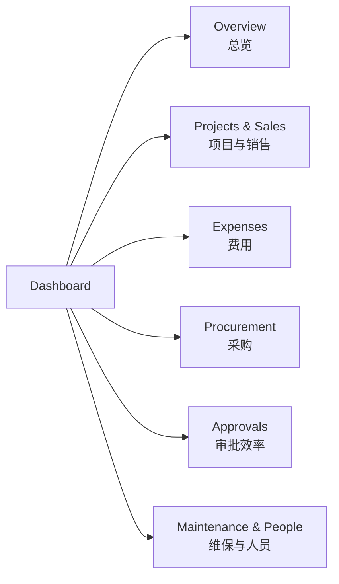

界面样稿（第一期四个页面 + 第二期两个页面，示例数据）：[AIIS Operations Dashboard Mockups](https://claude.ai/artifact/MjS7N5S9Ycqvte9tDxGtHe)。

页面顶部是期间筛选；Overview 是一排关键数字，其余页签各自是“卡片 + 趋势图 + 明细表”。点击趋势图上的柱子，整个页面切换到那一天（月视图）或那个月（季、年视图）；明细表里看板用户有权打开的单据可以点开，没有权限的只显示名称（只读）。

#### 6.9.3 指标

**Overview（总览）：** 卡片按经营上的重要性排列：先看生意（订货、收入、合同），再看钱和流程卡在哪里（采购、待审批、待付款），最后是费用。

| 顺序 | 卡片 | 含义 | 来源 |
|---|---|---|---|
| 1 | Sales Order Value | 与 Finance › Overview 相同（调用 6.8.2 的计算） | 财务板块 |
| 2 | Recognized Revenue | 与 Finance › Overview 相同（调用 6.8.2 的计算） | 财务板块 |
| 3 | New Contracts | 期间内批准的项目合同金额（大字），合同份数写在下面一行 | 项目合同 |
| 4 | Purchase Orders Approved | 期间内批准的 PO 金额，分内部 / 项目 | PO |
| 5 | Pending Approvals (Now) | 当前所有待审批的单据数，以及等待最久的单据和天数 | 审批引擎 |
| 6 | Awaiting Payment (Now) | 已批准、等 CFO 付款的 PO 和报销金额 | PO、报销单 |
| 7 | Sales Expense Budget | 销售费用预算的使用率和超出金额；有多个部门设了预算时，改为显示超预算的部门数 | 部门预算 |
| 8 | Employee Expenses | 期间内员工费用报销金额（口径同 Expenses 页签） | 报销单 |

卡片下方：每天的订货金额和已确认收入（柱状图，与财务板块同口径）、各审批人手上的待审单据（Now）；最下面是批准的 PO（内部 / 项目）和按部门的员工费用。每天员工费用的走势图只在 Expenses 页签显示。

**Expenses（费用）：**

| 指标 | 口径 |
|---|---|
| 员工费用报销金额 | 已批准及以后（已过账、已付款）的报销单，**按费用发生日期**计入期间；按部门、费用类别（餐饮、差旅住宿、礼品等）、报销类型（销售费用 / 项目差旅 / 其他）拆分；趋势图按天显示每天的员工费用 |
| 审批中的报销 | 已提交、尚未批完的报销金额和笔数（Now） |
| 待付款的报销 | 已批准、尚未付款的金额（Now），对应 CFO 的 Post and pay 待办 |
| 销售费用 vs 部门预算 | 每个部门的预算、已占用、剩余、使用率（口径同第 5 节“已占用的算法”）；超预算标红 |
| 超出申请金额的报销 | 实际超过事前申请金额的次数和超出金额，按部门和人员 |
| 出差 | 期间内出差（销售出差 + 交付 / 维保出差）的次数、天数、差旅费用，按项目和人员 |

**Procurement（采购）：**

| 指标 | 口径 |
|---|---|
| 新增 PR | 期间内提交的 PR 数和参考金额，分内部采购 / 项目采购 |
| 批准的 PO | 期间内 CEO（及 Chairman）批准的 PO 金额和笔数，按供应商、部门 / 项目 |
| 待付款的 PO | 已批准、等 CFO 付款的 PO 金额和笔数（Now） |
| 已付款未收货 | 已付款但还没登记收货的 PO（Now），按付款后天数排序 |

**Approvals（审批效率）：**

| 指标 | 口径 |
|---|---|
| 当前待审批 | 按审批人统计笔数和最长等待天数（Now），可看出谁那里压着单子 |
| 平均审批时长 | 期间内批完的单据，从提交到最后一级批准的平均天数，按单据类型（PR、PO、报销、出差、销售费用、项目各关口、合同） |
| 驳回率 | 期间内驳回次数 / 提交次数，按单据类型和部门；明细可看驳回原因 |

**Projects & Sales（项目与销售，第二期）：**

| 卡片 | 含义 | 口径 |
|---|---|---|
| Active Projects (Now) | 进行中的项目数，另显示暂停的项目数 | 状态 In Progress / Paused，不含关闭 |
| Quotations Sent | 期间内发给客户的报价金额（大字），报价份数写在下面一行 | 进入 Quotation Sent 的日期；报价未税金额 |
| Win Rate | 期间内客户做出决定的报价中，接受的占比 | 接受 /（接受 + 拒绝关闭 + 拒绝暂停）；同时显示各自的数量 |
| Contracts Approved | 期间内 CEO 批准的项目合同金额（大字），合同份数写在下面一行 | 与 Overview 的 New Contracts 相同 |
| New Projects | 期间内立项获批的项目数 | 立项审批通过的日期 |
| Over-budget Deliveries (Now) | 交付中、已批准项目 PO 超过成本预算的项目数 | 已承诺 > 成本预算（4.4，#61） |

| 图表 / 明细 | 内容 |
|---|---|
| 项目漏斗（Now） | 立项、方案（含询价、报价）、合同、交付、维保五个阶段各有多少个项目和报价金额；暂停的单独一列 |
| 各阶段停留时间 | 期间内离开某阶段的项目，在该阶段平均停留的天数；另列“当前在某阶段停留最久的项目”（Now），看哪个项目卡住了 |
| 客户决定 | 期间内每个客户决定：项目、客户、销售、报价金额、结果（接受 / 拒绝关闭 / 拒绝暂停）、原因 |
| 按销售人员 | 期间内每个销售：发出的报价数、接受数、赢单率、合同金额 |
| 交付中项目的预算（Now） | 项目、客户、项目经理、成本预算、已承诺、待批准、剩余、使用率；超预算标橙色 |
| 暂停的项目（Now） | 项目、客户、暂停原因、预计重启日期；重启日期已过的标橙色 |

**Maintenance & People（维保与人员，第二期）：**

| 卡片 | 含义 | 口径 |
|---|---|---|
| Under Maintenance (Now) | 维保中的项目数 | 阶段为维保 |
| Ending within 90 Days (Now) | 90 天内维保到期的项目数和合计合同金额 | 维保结束日期；提醒续约 |
| Service Hours | 期间内登记的服务工时 | 服务记录的日期 |
| Hours Almost Used (Now) | 工时额度用到 80% 以上的项目数 | 已批工时 − 已用工时 |
| Maintenance Revenue | 期间内确认的维保收入 | 调用财务数据（维保收入分期，6.8） |
| Personnel Cost | 期间内人员成本 | 调用财务数据（6.6，与损益表 Personnel cost 一致） |
| Headcount | 期末在职人数，及期间内入职 / 离职人数 | 入职按员工第一份合同的开始日期，离职按离职日期 |

| 图表 / 明细 | 内容 |
|---|---|
| 维保项目（Now） | 项目、客户、维保结束日期、剩余天数、已批工时、已用、剩余、使用率；工时用到 80% 以上、或 90 天内到期的标橙色 |
| 每天的服务工时 | 期间内按天的服务工时，按项目分色；下方按工程师统计工时 |
| 人员成本 | 按部门和按成本类型（工资、签证、Iqama 等）拆分，与上一期对比 |
| 人数 | 按部门的期末人数、入职、离职 |

#### 6.9.4 实现方式

| 部分 | 方式 |
|---|---|
| 模块 | 新模块 `aiis_dashboard`，依赖各业务模块和 `aiis_finance`（调用其总览计算）；不改动财务板块 |
| 页面 | 自研页面（与 Finance › Overview 同样的做法），图表用 Odoo 自带的 Chart.js；本库品牌色主题（见第 8 节主题色） |
| 计算 | 后端按期间汇总，先校验用户在 Operations Dashboard 组里，再以系统权限读取全公司数据；只返回统计结果和明细行，不开放底层单据的权限 |
| 权限组 | Operations Dashboard (CEO, Chairman)：按 CEO、Chairman 职位的任职人自动维护 |
| 分期 | 第一期：Overview、Expenses、Procurement、Approvals；第二期：Projects & Sales、Maintenance & People |
| 第二期需要补的数据 | 项目上新增**客户决定结果和日期**（接受 / 拒绝关闭 / 拒绝暂停），在销售登记客户决定时写入；已有项目从聊天记录里的决定消息回填。各阶段停留时间用项目状态的变更记录（Odoo 字段跟踪）计算，不另建表 |

---

## 7. 审批引擎设计（自研 `aiis_approval`）

### 7.1 选型结论

调研了 OCA 的 `base_tier_validation`（Odoo 17.0）后决定**自研**。原因：

| OCA 模块的情况 | 对我们的影响 |
|---|---|
| 审批级别是事先固定的几级，不能“沿汇报链走到某一职级为止” | 层级链要靠预设多级 + Python 公式拼出来，跳级、交给 CEO 的规则也要写在公式里，难维护 |
| 驳回后单据停在原状态，需要手动重新发起 | 与“驳回退回草稿”不一致 |
| 一张单据只有一个审批关口 | 项目主档有多道关口，套不进去 |
| 中文翻译约完成一半；许可证 AGPL-3 | 界面需补翻译；与我们模块的 LGPL 不同 |

借鉴它的做法：审批记录表、待办提醒、同一人自动通过、改派。

### 7.2 核心概念

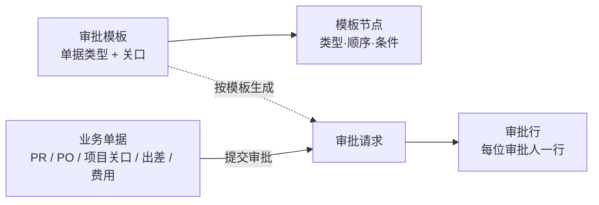

| 概念 | 内容 |
|---|---|
| **审批模板** | 一类单据（或项目的一道关口）用哪套审批规则。字段：名称、适用单据、关口代码（项目才有，例如立项、方案、询价、合同、交付确认、关闭）、是否启用、节点列表 |
| **职能职位** | 系统里维护的职位清单，每个职位指定**一位任职人**。预设 CEO、Chairman、CFO，可以增加。换人只需改任职人；职位空缺时，用到该职位的单据不能提交 |
| **模板节点** | 字段：顺序号、节点类型（层级链 / 指定部门负责人 / 职能职位）、类型参数（层级链终点：部门负责人或 CEO；指定的部门；指定的职能职位）、条件（例如金额 > 300,000 SAR）。**顺序号相同的节点并行** |
| **审批请求** | 单据每提交一次生成一条。字段：单据、关口、模板、提交人、提交时间、状态（审批中 / 已批准 / 已驳回 / 已撤回） |
| **审批行** | 名单上的每一位审批人一行。字段：顺序号、审批人、来源节点、状态（等待中 / 待审批 / 已批准 / 已驳回 / 自动通过 / 已改派）、审批时间、意见 |

### 7.3 提交时生成审批名单

按模板节点的顺序逐个展开，结果写入审批行并**固定**：

| 节点类型 | 展开方式 |
|---|---|
| 层级链 | 按 2.2 的规则沿汇报链往上，每一级一行，直到终点职级 |
| 指定部门负责人 | 该部门档案里的负责人一行 |
| 职能职位 | 该职位的任职人一行 |
| 条件不满足 | 该节点跳过，不生成审批行 |

- **去重**：同一个人出现多次时只保留最早的一行，后面的行标记为“自动通过”。
- **找不到审批人**（例如还没有人被设为 CFO）：不允许提交，并提示缺少哪个角色，由管理员配置后再提交。

### 7.4 审批运行规则

| 规则 | 内容 |
|---|---|
| 推进 | 当前顺序号的审批行全部批准后，下一顺序号的行变为“待审批”，并给审批人发待办 |
| 完成 | 所有行都批准后，审批请求变为“已批准”，单据执行后续动作（例如 PO 生效、项目进入下一阶段） |
| 驳回 | 任意一位审批人驳回（必须填意见）→ 审批请求“已驳回”，单据退回草稿；重新提交时重新生成名单 |
| 撤回 | 提交人可以在审批完成前撤回，单据退回草稿 |
| 修改后重审 | 每类单据可以设定“哪些字段修改后需要重新审批”（例如 PO 的明细和币种）；审批途中修改了这些字段，审批请求作废并重新生成 |
| 改派 | 审批人离职或长期不在时，**只有管理员**可以把其待审批行改派给其他人，保留改派记录 |
| 记录 | 每次提交、批准、驳回、撤回、改派都记在单据的聊天记录里 |

### 7.5 单据接入方式

所有需要审批的单据接入同一个通用组件，统一提供：

- 按钮：**提交审批 / 批准 / 驳回 / 撤回**（只对有权限的人显示）
- **审批进度**页签：显示每一行的审批人、状态、时间、意见
- 字段：当前审批人、审批状态，可以在列表里搜索和筛选

每类单据只需要告诉引擎三件事：**申请人是谁、用于条件判断的金额是多少、批准或驳回后要做什么**。

项目主档有多道关口，每道关口对应一个模板，各自生成审批请求，互不干扰。

### 7.6 界面与权限

| 内容 | 说明 |
|---|---|
| 职能职位配置 | 设置 › 职能职位，只有管理员能改；指定任职人与授予权限组是两件事，需分别设置 |
| 审批模板配置 | 设置 › 审批模板，只有管理员能改。系统预装与 2.4 一致的默认模板，预装后可以在界面上调整，升级模块不会覆盖 |
| **我的待审批** | 统一菜单，汇总所有类型单据中等待我审批的行，一次处理完；原来的“PRs To Approve”“POs To Approve”并入这里 |
| 谁能看审批记录 | 审批记录本身：提交人、名单上的审批人、管理员；能打开单据的人在单据的 Approvals 页签上看到审批进度（只读） |
| 界面语言 | 英文；以后增加阿拉伯语和中文翻译 |

### 7.7 迁移现有审批

| 现有内容 | 处理方式 |
|---|---|
| PR 审批（只批直属上级一级 + 采购负责人兜底） | 改用引擎，模板为“层级链至部门负责人” |
| PO 审批（代码写死的 CEO / Chairman 逻辑） | 改用引擎，模板为“CEO → Chairman（> 300,000 SAR）”，行为不变 |
| CEO、Chairman 权限组 | 保留，只负责查看和操作权限；审批人改由职能职位的任职人决定 |
| PR 备用审批人权限组 | 取消 |
| “PRs To Approve”“POs To Approve”菜单 | 并入“我的待审批” |
| 测试库中审批到一半的单据 | 迁移时退回草稿重新提交（只是测试数据） |

---

## 8. 与现有模块的关系

| 现有功能 | 在新流程中的用法 | 需要的改动 |
|---|---|---|
| 审批引擎（新） | 所有单据共用，见第 7 节 | 新建自研模块 `aiis_approval` |
| 采购申请 PR | 内部采购；项目交付、维保阶段由项目经理按 BOM 分批提 | 迁移到审批引擎（见 7.7）；关联项目和 BOM 行，统计已申请数量；项目 PR 不审批，提交后直接到采购 |
| 维保工时申请（新） | 内部服务人员申请和延长工时额度 | 新建单据，接入审批引擎；服务记录按额度控制 |
| 部门费用预算（新） | 销售费用审批时显示预算和剩余 | 新建预算设置（CFO 维护），按部门、年度 / 季度统计占用 |
| 采购订单 PO + CFO / CEO / Chairman 审批 | 两条流程共用 | CFO 前置确认供应商条件，最终审批后按阶段执行付款与收货 |
| PR 备用审批人权限组 | — | 取消，由 2.2 的“跳级 / 交给 CEO”规则代替 |
| 产品类别、会计科目 | 项目成本 / 营业费用分类 | 按 6.5 调整 |
| 销售报价单 / 销售订单 | 方案阶段生成报价，客户接受后转订单 | 从 BOM + 利润点生成报价 |
| 客户合同 | 非项目销售保持现状；项目销售由项目合同关口代替 | 项目的销售订单在项目合同批准后自动确认，不再检查客户合同 |
| 费用报销（Expenses） | 差旅报销、销售费用 | 接入审批引擎；差旅关联出差申请和项目，记为项目成本 |
| 财务看板 | 财务板块：Overview + Reports（见 6.8） | 改造为 Overview 和 Cash Flow；Revenue / Cost / Expense / Overall Profit 菜单并入 Cash Flow |
| 界面语言 | 全部模块 | 界面文字统一为英文源文本；以后补充阿拉伯语、中文翻译文件 |
| 财务报表（新） | 损益表、资产负债表、账龄、项目损益 | 安装并配置 OCA `mis_builder`、`account_financial_report`、`partner_statement`（见 6.7.6） |
| 固定资产（新） | 单价 ≥ 5,000 SAR 的设备 | 安装 OCA `account_asset_management` |
| 维保收入分期（新） | 预收维保收入按期确认 | 安装 OCA `account_spread_cost_revenue` |
| 主题色 | 全系统跟随本库的品牌色：AIIS 绿色 #059669，MHTT 深蓝 #233D7E（两家公司同一套代码、各自的服务器和库） | 品牌色只在一处设置：公司的主色（Settings › Companies › Document Layout 的 Primary Color，打印单据也用它）。保存后本库的界面样式重新编译，按钮、链接、导航栏渐变、登录页、Dashboard 和 Finance 看板的主色、打印单据一起变；浅色和深色由主色自动推算。看板里表示涨跌、警告、好坏的颜色是固定的语义色，不跟随品牌色；图表的第二种颜色避开和主色同一色系（蓝色主题用绿，其他用蓝）。代码里不写公司名或颜色 |

---

## 9. 决策记录（原“待确认事项”）

| # | 问题 | 目前的设计 |
|---|---|---|
| 1 | 销售费用是事前申请还是事后报销 | **已确认**：事前申请 + 事后报销，都走层级链至 CEO |
| 2 | 销售出差、请客、礼品费用的类别 | **已确认**：Sales expenses › Sales travel and entertainment |
| 3 | 项目编号流水号的范围 | **已确认**：每个客户、每年从 001 开始，例如 STC-2026-001 |
| 4 | 暂停的项目重启后从哪里开始 | **已确认**：回到方案设计，BOM 和询价沿用后更新 |
| 5 | 维保收入的确认方式 | **已有方案**（见 6.7.4）：开票后挂预收收入，按约定时间点分期确认 |
| 6 | CFO 账号 | **已确认**：新建 CFO 用户，并指定为 CFO 职位的任职人 |
| 7 | 立项时的项目机会从哪里来 | **已确认**：先在立项申请里直接填写；以后可接 CRM |
| 8 | 内部采购的 CFO 付款如何在系统中体现 | **已有方案**（见 6.7.4）：PO 收货后录入供应商账单，CFO 在 Odoo 中登记付款并核销应付 |
| 9 | 职能节点由谁审批 | **已确认**：指定到具体职位（如 CFO），由该职位的任职人审批 |
| 10 | 提交人能否在审批完成前撤回 | **已确认**：可以，撤回后退回草稿 |
| 11 | 谁可以改派审批人 | **已确认**：只有管理员 |
| 12 | 损益表口径 | **已确认**：按权责发生制；损益表、资产负债表、应收应付方案见 6.7；现有看板保留为现金流视图 |
| 13 | 研发人员的非项目差旅归哪一行 | **已确认**：R&D › Other R&D expenses |
| 14 | 设备是否折旧 | **已确认**（修订）：资本化门槛 **单价 5,000 SAR**；低于门槛一次性计入费用，达到门槛登记固定资产并折旧，折旧统一计 G&A |
| 15 | 人员成本 | **已确认**（见 6.6）：HR 按员工逐笔录入签证费、Iqama、保险、社保等，员工本人不可见，按实际发生时计入 Personnel cost；合同工资按月计入 |
| 16 | 礼品归哪一行 | **已确认**：与招待一起归 Sales travel and entertainment |
| 17 | 采购部、CEO、Chairman 的费用归哪一大类 | **已确认**：G&A |
| 18 | 不折旧的设备支出归哪一明细 | **已确认**：不论部门，统一归 G&A › Other administrative expenses |
| 19 | 预扣税（Withholding tax） | **已确认**：暂不做；以后有境外供应商时再加，方案见 6.7.4 |
| 20 | 固定资产折旧年限 | **已确认**：电脑、笔记本 3 年；服务器、网络设备 5 年；家具 5 年 |
| 21 | 员工服务终止补偿暂不计提、资本化门槛 5,000 SAR | **已确认**：终止补偿暂不计提。以后如做年度审计，再请审计师确认这两项 |
| 22 | Odoo 是否作为正式账簿，由谁记账 | **已确认**：Odoo 作为正式账簿，由 **CFO** 负责记账、对账、月结 |
| 23 | Zakat 和所得税在损益表上的列示 | **已确认**：拆成 Zakat、Income tax 两行 |
| 24 | 员工服务终止补偿是否按月计提 | **已确认**：现阶段不计提，离职支付时计入费用；以后再加 |
| 25 | 固定资产折旧计入哪一大类 | **已确认**：统一计 G&A › Depreciation and amortization |
| 26 | 合同阶段 CFO 审批什么、驳回到哪里 | **已确认**：CFO 审批价格、商务条款、付款周期、付款条件；CEO 仍为最终审批；任何一位驳回都回到销售 |
| 27 | 交付阶段谁发起项目 PR，PR 是否审批 | **已确认**：项目经理查看 BOM 并按进度发起；项目 PR 不经层级审批，直接到采购 |
| 28 | 项目采购的付款和收货 | **已确认**：CEO 批准 PO 后转 CFO 付款；付款后采购监控发货并登记收货 |
| 29 | 维保服务人员的工时 | **已确认**：内部人员提交工时申请（不产生采购），层级链至部门负责人；额度用完再提交延长申请 |
| 30 | 销售费用的预算和 CFO | **已确认**：CFO 设置部门销售费用预算，审批人看到所在部门的预算和剩余；事后报销在 CEO 之后加 CFO 最终审批并付款；CFO 拒绝退回发起人 |
| 31 | 维保工时如何计入项目成本 | **已确认**：只展示工时，不折算成本、不计入项目成本（人员工资已在 Personnel cost 中） |
| 32 | 界面语言 | **已确认**：Odoo 前端统一英文；以后增加阿拉伯语和中文 |
| 33 | 财务总览显示什么 | **已确认**：Sales Order Value、Recognized Revenue、Gross Profit、Order Backlog 四项（口径见 6.8.2） |
| 34 | 财务报表包括哪些 | **已确认**：Profit & Loss、Balance Sheet、Receivables & Payables、Cash Flow，另加核对区 Checks |
| 35 | 财务数据是否包含预测 | **已确认**：不做预测，全部按实际发生统计；不安装 `mis_builder_budget` |
| 36 | 谁能看财务板块 | **已确认**：整个财务板块（Overview、Reports、导出）只给 CFO、CEO、Chairman |
| 37 | 利润点的算法 | **已确认**：毛利率，报价 = 成本 ÷ (1 − 利润点) |
| 38 | 谁能看到项目 | **已确认**：只看自己参与的（发起销售、项目经理、项目成员、审批人）；采购、CFO、CEO、Chairman 看全部（见 4.7） |
| 39 | 合同阶段成本变化后的报价 | **已确认**：成本持平或下降按原价签合同；成本上涨先与客户谈，再重新报价（走询价审批），客户接受后再进合同（见 4.4） |
| 40 | 项目销售订单的确认 | **已确认**：项目合同审批代替客户合同，批准后自动确认销售订单；非项目销售仍走客户合同 |
| 41 | CFO 付款在系统中的做法 | **已确认**：PO 批准后自动生成供应商账单草稿（按订单数量），CFO 确认账单并在 Odoo 登记付款；新订单按 #58 的阶段金额、节点和日期控制，旧批准订单保留原付款顺序。内部采购和项目采购相同 |
| 42 | 谁指定项目经理 | **已确认**：CEO 在合同阶段指定（销售立项时可先建议）；提交立项后只有 CEO 和管理员能改；合同批准前必须指定（见 4.7） |
| 43 | 谁能维护 BOM 行 | **已确认**：研发部员工（含部门负责人）；采购只填成本，其他人只读（见 4.8） |
| 44 | 销售费用的部门预算给谁看 | **已确认**：审批人、CFO、CEO（及管理员）；申请人看不到（见第 5 节） |
| 45 | 费用记到哪个科目在系统中怎么实现 | **已确认**：映射表，产品类别（性质）× 部门职能 → 科目，CFO 维护；新增明细只改映射表（见 6.8.7） |
| 46 | Cash Flow 的“已与银行核对”怎么实现 | **已确认**：安装 OCA `account_reconcile_oca`，CFO 录入 / 导入银行流水并核对；Cash Flow 只分类已核对的流水，其余银行变动列为 Other and not yet reconciled |
| 47 | ZATCA 电子发票什么时候做 | **已确认**：第 8 步先不做，待会计确认要求并取得 ZATCA 证书后单独作为第 9 步 |
| 48 | PR 批准后通知谁转 PO | **已确认**：只通知采购部的采购人员，按钮也只给他们；CEO、CFO、Chairman 即使有采购权限也不收到（测试中发现 CEO 收到“Create purchase order”待办，分不清哪些该他处理）。统一 To do 直接列出当前用户的审批和业务处理任务，采购在其中处理已批准、待转 PO 的 PR；采购菜单另保留 Purchase Requests to Convert 查询入口；采购部成员由系统按部门自动维护在权限组 Procurement Department (Buyer) |
| 49 | PR 申请人能否填价格 | **已确认**：可选填参考单价和币种，申请人和审批人可见；采购仍然询价，CEO 照常审批 PO；采购改动后的 PO 价格申请人仍看不到 |
| 50 | Chairman 能否看全部项目 | **已确认**：继续看全部项目（维持 #38） |
| 51 | 采购能否看销售订单 | **已确认**：不能；只在 PR / PO 上看到销售订单号；Sales 板块不对采购显示 |
| 52 | 谁算“销售” | **已确认**：按部门自动判断，Sales 部门（含下级部门）的员工进入 Sales 板块并获得销售权限，不在账号上手工勾选 |
| 53 | 销售能看哪些客户合同 | **已确认**：只看自己参与的（自己是销售或该合同的审批人）；销售部门负责人看本部门的；CEO、CFO 看全部 |
| 54 | CEO / Chairman 驳回 PO 后单子去哪里 | **已确认**：回到采购（PO 退回草稿，采购按意见修改后重新提交），驳回原因写到 PR 上并通知申请人（测试中发现驳回后没人知道单子去了哪里） |
| 55 | 驳回后是否给提交人发待办 | **已确认**：所有单据都发，待办里写明驳回原因，点开就是那张单据 |
| 56 | 被驳回的单子怎么找 | **已确认**：统一 To do 的 To Revise 筛选显示待修改重提的单据（所有账号、所有单据类型），不再使用 Returned to Me 子菜单；PO 和 PR 表单顶部显示红色驳回横幅（测试中发现驳回的 PO 混在询价单里很难找） |
| 57 | CFO 能否修改已批准采购的账单价格 | **已确认**：采购商业条件以批准 PO 为准，草稿账单锁定商业字段，确认和付款后端核对；有差异退回采购修改 PO 并重新审批，已有过账账单先作账务更正（3.2.1） |
| 58 | 谁确认供应商付款条件、如何分阶段付款 | **已确认**：采购取得供应商条件和依据，CFO 可确认或退回谈判／澄清，确认后才交 CEO／Chairman；付款按预付、收货、验收及约定日期逐阶段受控（3.2.2） |
| 59 | 方案文档怎么提交 | **已确认**：研发上传到项目的 Solution Documents，提交方案时必填；文档随 BOM 版本保存副本，CEO 审批的是该版本；合同阶段确认 BOM 时可以更新文档并另存版本（4.3、4.4、4.8）。BOM 行的 Excel 导入暂不做 |
| 60 | 项目上销售的操作谁能做 | **已确认**：本项目的发起销售，以及其所在部门的负责人（部门负责人权限始终大于普通员工，可代下属操作；只到直属部门负责人，CEO、Chairman 不代为操作）和系统管理员；研发等其他成员不能（测试中发现研发账号能看到 Customer Accepted / Rejected）（1.4、4.4） |
| 61 | 报价前 CFO 确认哪些财务事项 | **已确认**：CEO 定利润点后由 CFO 填写并确认客户付款周期和付款条件、项目成本预算（超预算只提示不拦截）、税项和外币成本汇率，报价币种只用 SAR；CFO 批准后报价才交销售（4.3、4.4） |
| 62 | 合同阶段研发与采购如何核对 | **已确认**：收到客户 PO 后研发确认 BOM、采购确认价格同时进行，采购每次都确认（一个 Confirm Prices 按钮，过期或变更的行先重新报价），两者都完成才比较成本、进入合同条款或重新报价；项目表头在所有阶段显示当前步骤、待谁处理、已完成的人（测试中发现 BOM 未变时跳过了采购，且提示只显示审批人）（4.4、4.7） |
| 63 | 合同审批由谁审、付款条件何时确认 | **已确认**：合同审批改为 CFO → CEO，取消研发部门负责人节点（研发已在合同核对时确认 BOM）；合同条款（商务条款、付款周期、付款条件）在收到客户 PO 后由销售填写，CFO 在合同审批中最终确认；报价前 CFO 不再确认付款条件，只确认成本预算、税项和汇率（修订 #26、#61）（4.3、4.4） |
| 64 | PR / PO 是否也显示流程提示 | **已确认**：与项目一致，PR 和 PO 表头显示当前步骤和待谁处理，内容取自 To do 的未完成任务（PR 转 PO 后显示 PO 及其账单的进度）（测试中发现提交项目 PR 后不知道下一步谁处理） |
| 65 | 员工批准后在哪里报销 | **已确认**：销售费用申请和出差申请批准后，直接在申请单上填实际费用、传票据、Submit Claim，系统生成费用报告走报销审批；每张申请只报销一次、一次性提交；实际超过申请金额允许提交并标红提示；Expenses 里手动建报告的方式保留为备用入口（测试中发现员工找不到报销入口）（4.5、5） |
| 66 | 管理层运营看板 | **已确认**：新增独立的 Dashboard 板块（运营看板），只给 CEO 和 Chairman 看；与财务板块是两个功能，可以有相同的数字，需要财务数字时调用财务板块的计算；默认显示本月，可切换日 / 月 / 季 / 年并与上一期对比（6.9） |

---

## 10. 开发计划

| 步骤 | 内容 | 状态 |
|---|---|---|
| 1 | 调研 OCA `base_tier_validation`，决定审批引擎方案 | 已完成：自研（见 7.1） |
| 2 | 自研审批引擎 `aiis_approval`：模板与节点、生成名单、运行规则、通用接入组件、“我的待审批”菜单（见第 7 节） | 已完成（2026-10-26，测试库） |
| 3 | 把现有 PR、PO 审批迁移到审批引擎（见 7.7） | 已完成（2026-10-26，测试库） |
| 4 | 项目第一期：项目主档、客户编码与项目编号、立项、BOM、方案设计、暂停 / 关闭 | 已完成（2026-10-26，测试库，模块 `aiis_project`）；BOM 的“已申请 / 已下 PO / 已收货”列随第三期项目 PR 一起做 |
| 5 | 项目第二期：合同（研发确认 BOM、重新询价、研发部门负责人 ∥ CFO → CEO） | 已完成（2026-10-27，测试库）：含成本上涨重新报价、项目合同批准后自动确认销售订单 |
| 6 | 项目第三期：交付与维保（项目经理发起项目 PR、CFO 付款、出差申请与差旅报销、交付确认、维保工时申请与延长、关闭） | 已完成（2026-10-27，测试库） |
| 7 | 销售出差与销售费用（事前申请 + 事后报销、部门预算、CFO 最终审批与付款） | 已完成（2026-10-27，测试库，模块 `aiis_sales_expense`；菜单 Sales › Sales Expenses，预算在其下的 Budgets） |
| 8 | 财务报表与财务口径（6.7、6.8）：Finance 菜单 Overview 与 Reports、科目表、分析维度、业务到凭证、损益表 / 资产负债表 / 账龄、固定资产、维保收入分期 | 已完成（2026-10-27，测试库，模块 `aiis_finance` + `addons/oca/`） |
| 9 | ZATCA 电子发票（`l10n_sa_edi`，#47） | 待会计确认 |
| 10 | 权限按流程收紧（1.4，#50–#53）：板块入口按角色、客户合同只看参与的、销售按部门自动给权限、去掉 Dashboards 和 Apps 的普通用户入口 | 已完成（2026-10-28，测试库，模块 `aiis_access`；销售权限组 Sales Department (automatic) / Sales Department Head (automatic) 由部门自动维护） |
| 11 | 运营看板 `aiis_dashboard`（6.9，#66）：第一期 Overview、Expenses、Procurement、Approvals；第二期 Projects & Sales、Maintenance & People | 已完成（2026-11-08，测试库，两期一起实现；菜单 Dashboard；项目上新增客户决定结果和日期并已回填） |

---

## 附录：修订记录

| 版本 | 日期 | 修改 |
|---|---|---|
| v0.1 | 2026-10-18 | 项目审批流程初稿（五个阶段、二级流程、功能设计） |
| v0.2 | 2026-10-18 | 立项改为附项目资料（不是 RFP）；合同阶段增加“研发确认 BOM 是否过时”；新增内部采购流程 |
| v0.3 | 2026-10-20 | 汇总为本设计文档，作为唯一正式版本 |
| v0.4 | 2026-10-20 | 新增审批机制（三个职级、三类节点、层级链规则）；PR 层级链至部门负责人，出差与差旅报销至 CEO；汇报链断开时跳级、最终交给 CEO，取消 PR 备用审批人；销售 / 研发主管统一为部门负责人；新增销售费用申请（部门负责人 → CEO） |
| v0.5 | 2026-10-20 | 审批引擎选定自研（OCA 调研结论见 6.1）；新增第 6 节“审批引擎设计”（模板、节点、名单生成、运行规则、接入方式、界面权限、迁移）；新增待确认 #9–#11；章节顺延 |
| v0.6 | 2026-10-20 | 职能节点改为“职能职位”：每个职位指定一位任职人审批（CEO、Chairman、CFO 可增加），权限组只管权限；确认撤回退回草稿、只有管理员可改派；销售出差与请客礼品费用的类别待确认 |
| v0.7 | 2026-10-20 | 销售出差与销售费用确认为事前申请 + 事后报销，归 Sales › Sales travel and entertainment；新增第 6 节“财务口径”（依据 2026 损益表模板：三大类营业费用及明细、按职能 × 性质归类）；交付与销售出差的归属分开；新增待确认 #12–#17；章节顺延 |
| v0.8 | 2026-10-20 | 确认：设备一次性计入费用不折旧（D&A 行为 0）、研发非项目差旅归 R&D › Other、礼品归销售差旅与招待、采购部 / CEO / Chairman 归 G&A；人员成本补充签证费、Iqama 费（讨论中）；损益表口径讨论中；新增待确认 #18（设备归哪一明细） |
| v0.9 | 2026-10-20 | 确认 #18：非项目设备不论部门，统一归 G&A › Other administrative expenses |
| v0.10 | 2026-10-20 | 确认 #12 损益表按权责发生制（报表实现方案待确认）；确认 #15 人员成本由 HR 逐笔录入、员工不可见、按实际发生计入，新增 6.6 |
| v0.11 | 2026-10-21 | 新增 6.7 财务报表方案（权责发生制：数据流、科目与维度、记账方式、Zakat 与所得税、报表工具、资产负债表结构、前提条件、实施顺序）；所得税拆为 Zakat / Income tax 两行；员工服务终止补偿暂不计提；资本化门槛 5,000 SAR，折旧统一计 G&A（修订 #14）；新增待确认 #19–#25 |
| v0.12 | 2026-10-22 | 确认折旧年限（3 / 5 / 5 年）、终止补偿暂不计提、Odoo 作为正式账簿由 CFO 负责；补充预扣税的系统方案（6.7.4），是否适用待确认 |
| v0.13 | 2026-10-22 | 预扣税暂不做，以后有境外供应商时再加 |
| v1.0 | 2026-10-22 | 确认 #3、#4、#6、#7、#15（工资按月计入）；所有待确认事项均已决定，设计定稿，待开发 |
| v1.1 | 2026-10-26 | 汇报后修改：合同阶段 CFO 审批价格与商务条款、付款周期、付款条件，驳回回到销售；交付阶段由项目经理发起项目 PR，不经层级审批直接到采购，CEO 批准 PO 后 CFO 付款，采购监控发货和收货；维保新增内部工时申请与延长申请（层级至部门负责人）；销售费用新增部门预算，报销加 CFO 最终审批并付款，CFO 拒绝退回发起人；新增角色“项目经理”；新增决策 #26–#30、待确认 #31 |
| v1.2 | 2026-10-26 | 确认 #31：维保工时只展示，不计入项目成本 |
| v1.3 | 2026-10-26 | 界面语言统一为英文（以后加阿拉伯语、中文）；新增 6.8 财务板块：Overview 四项指标（Sales Order Value、Recognized Revenue、Gross Profit、Order Backlog）、Reports（P&L、Balance Sheet、AR/AP、Cash Flow、Checks）、口径、权限、实现方式；新增决策 #32–#34 |
| v1.4 | 2026-10-26 | 去掉预测：财务数据全部按实际发生统计，Overview 与各报表不再显示 Forecast，取消 `mis_builder_budget`；新增决策 #35 |
| v1.5 | 2026-10-26 | 确认财务板块只给 CFO、CEO、Chairman 查看（#36） |
| v1.6 | 2026-10-26 | 新增界面设计：BOM 页面（4.8）和 Profit & Loss 报表（6.8.3），附样稿链接 |
| v1.7 | 2026-10-26 | 开发计划第 2、3 步完成：审批引擎上线测试库，PR / PO 审批已迁移（3.3）；7.6 补充：能打开单据的人在单据上看到审批进度 |
| v1.8 | 2026-10-26 | 确认 #37 利润点按毛利率、#38 项目只给参与人看（采购、CFO、CEO、Chairman 看全部）；项目一期开始开发 |
| v1.9 | 2026-10-26 | 开发计划第 4 步（项目一期）完成 |
| v1.10 | 2026-10-27 | 确认 #39 合同阶段成本上涨需重新报价、#40 项目合同代替客户合同并自动确认销售订单；项目二期开始开发 |
| v1.11 | 2026-10-27 | 开发计划第 5 步（项目二期：合同）完成 |
| v1.12 | 2026-10-27 | 确认 #41 CFO 付款用供应商账单 + 登记付款；补充交付验收、维保到期、出差与报销的实现方式（4.5、4.6） |
| v1.13 | 2026-10-27 | 开发计划第 6 步（项目三期：交付与维保）完成；内部采购步骤 6 CFO 付款已实现（3.3） |
| v1.14 | 2026-10-27 | 确认 #42 项目经理由 CEO 在合同阶段指定（4.7） |
| v1.15 | 2026-10-27 | 确认 #43 只有研发部员工维护 BOM 行、提交方案、确认 BOM（4.8）；项目资料附件归属项目 |
| v1.16 | 2026-10-27 | 确认 #44 预算只给审批人和 CFO/CEO 看；补充销售费用的实现方式和预算占用算法（第 5 节） |
| v1.17 | 2026-10-27 | 开发计划第 7 步（销售出差与销售费用）完成 |
| v1.18 | 2026-10-27 | 确认 #45 科目映射表、#46 银行对账用 OCA `account_reconcile_oca`、#47 ZATCA 另作第 9 步；开发计划第 8 步（财务报表与财务口径）完成，补充实现方式（6.7.6、6.8.7） |
| v1.19 | 2026-10-27 | 测试反馈：#48 PR 批准后只通知采购部转 PO，My Approvals 增加采购的“待转 PO”子菜单；#49 PR 申请人可选填参考价，采购仍询价（3.3 第 1、3 步，2.4 价格可见性） |
| v1.20 | 2026-10-28 | 新增 1.4 可见范围（流程不经过的人看不到）；新增角色“销售”（按 Sales 部门判断）；确认 #50 Chairman 继续看全部项目、#51 采购只看销售订单号、#52 销售按部门自动判断、#53 销售只看自己参与的客户合同；开发计划新增第 10 步 |
| v1.21 | 2026-10-28 | 开发计划第 10 步（权限按流程收紧）完成 |
| v1.22 | 2026-10-29 | 测试反馈：#54 PO 被驳回后回到采购并通知 PR 申请人；#55 任何单据被驳回，提交人都收到带原因的待办（2.3） |
| v1.23 | 2026-10-29 | 测试反馈：#56 My Approvals › Returned to Me 列出被驳回待重新提交的单据；PO、PR 表单显示驳回横幅（2.3） |
| v1.24 | 2026-11-04 | 确认 #57：采购账单商业条件锁定、确认及付款一致性校验、财务退回采购和重新审批闭环（3.2.1）；同步统一 To do 入口及财务职责描述 |
| v1.25 | 2026-11-04 | 确认 #58：CFO 前置审核、供应商条件与建议分离、按批准／收货／验收节点分阶段付款及待办流转（3.2.2） |
| v1.26 | 2026-11-05 | 测试反馈：确认 #59 方案文档上传（必填、随 BOM 版本保存，合同阶段确认 BOM 时可更新）（4.3、4.4、4.8） |
| v1.27 | 2026-11-05 | 测试反馈：PO 不再提供手工 Create Bill，账单只在最终批准时自动生成，误调用时打开已有账单（3.2.1） |
| v1.28 | 2026-11-05 | 测试反馈：方案文档可编辑时间改为与 BOM 行一致（询价等阶段也可补传），批准后改动记入消息记录（4.8） |
| v1.29 | 2026-11-05 | 测试反馈：确认 #60 项目上销售的操作只给发起销售及其部门负责人；新增原则“部门负责人权限始终大于普通员工”（1.4、4.4） |
| v1.30 | 2026-11-05 | 修订 #60：代为操作只到直属部门负责人，不含上级部门负责人；写明正式库系统管理员与 CEO 分账号（1.4、4.4） |
| v1.31 | 2026-11-05 | 测试反馈：确认 #61 询价审批改为 CEO → CFO，CFO 报价前确认付款条件、项目成本预算、税项和汇率；项目 PO 超预算提示（4.3、4.4、2.4） |
| v1.32 | 2026-11-05 | 测试反馈：确认 #62 合同阶段研发确认 BOM 与采购确认价格并行、采购每次确认；项目表头全阶段流程提示（4.4、4.7） |
| v1.33 | 2026-11-05 | 测试反馈：确认 #63 合同审批改为 CFO → CEO（取消研发部门负责人节点）；付款条件改在合同阶段由销售填写、CFO 确认，报价前 CFO 只确认预算、税项和汇率（4.3、4.4、2.4） |
| v1.34 | 2026-11-05 | 确认 #60 不适用于项目经理的操作：只由指定的项目经理本人操作，换人由 CEO 改项目经理（1.4） |
| v1.35 | 2026-11-05 | 测试反馈：确认 #64 PR、PO 表头流程提示，与 To do 同源 |
| v1.36 | 2026-11-05 | 测试反馈：采购供应商账单表头也显示流程提示（可付金额、下一阶段节点、负责人和可付日期）（#64） |
| v1.37 | 2026-11-08 | 测试反馈：确认 #65 销售费用申请和出差申请批准后直接在申请单上报销（Submit Claim 自动生成费用报告），每张申请只报一次，超申请金额标红不拦截，Expenses 手动建报告保留为备用（4.5、5） |
| v1.38 | 2026-11-08 | 新增 6.9 运营看板（Dashboard 板块）：只给 CEO 和 Chairman，与财务板块独立、可调用财务数据，默认本月，日 / 月 / 季 / 年与上一期对比；指标分 Overview、Expenses、Procurement、Approvals、Projects & Sales、Maintenance & People；新增决策 #66、开发计划第 11 步；同日补充：本期未过完时与上一期同一段时间对比，第一期界面样稿，Overview 按重要性排序（订货、收入在前，员工费用在后）；第二期 Projects & Sales、Maintenance & People 的卡片、图表和口径，项目上补客户决定结果和日期 |
| v1.39 | 2026-11-08 | 运营看板两期实现（模块 `aiis_dashboard`，开发计划第 11 步完成）；点击趋势图的柱子改为切换到那一天 / 那个月；权限组随 CEO、Chairman 职位的任职人自动更新；同日：页签顺序调整为 Overview、Projects & Sales、Expenses、Procurement、Approvals、Maintenance & People；Quotations Sent、Contracts Approved、New Contracts 卡片大字只显示金额，份数移到下面一行 |
| v1.40 | 2026-11-10 | 为正式部署做准备：3.2.1 补充固定资产按件拆分账单的例外（之前一张 PO 买 2 台以上达到门槛的设备时，CEO 批准生成账单会报错）；6.8.6 财务看板和银行对账权限随 CFO、CEO、Chairman 职位自动更新（原来只在安装时分配，正式库先装模块后导入人员会落空）；公司设置里选研发部门时，该部门的费用类别自动设为 R&D；安装时按科目类型找成本和费用科目，沙特科目表 `l10n_sa` 上可以全新安装；项目采购只认类别上明确设置的成本科目，不再误用沙特科目表的公司默认科目 400001；To do 按单据名称搜索 PR 时条件被忽略的问题已修复 |
| v1.41 | 2026-11-10 | 第 8 节主题色：按库跟随公司主色（AIIS 绿、MHTT 深蓝），一处设置，界面、登录页、看板、打印单据一起变 |
